<div align="center">

# Awesome Native Clients

**Faster, lighter clients for the apps you love, and the ones you're stuck with.**

Your chat app ships a whole web browser. So does your music player, your API client, and your editor.
This is a list of 50 open source projects that rebuilt them as real desktop apps: native UI, a fraction of the memory, and launch times you don't notice.

[](https://awesome.re)


[](CONTRIBUTING.md)

</div>

---

## Contents

- [Why this exists](#why-this-exists)
- [Before and after: the receipts](#before-and-after-the-receipts)
- [Pick a replacement](#pick-a-replacement)
- [How to read this list](#how-to-read-this-list)
- [Messaging, Social and Communities](#messaging-social-and-communities) (11)
- [Music, Video and Streaming](#music-video-and-streaming) (21)
- [Email and AI Workflows](#email-and-ai-workflows) (4)
- [Editors, Terminals and Developer Tools](#editors-terminals-and-developer-tools) (14)
- [Before you switch](#before-you-switch)
- [Contributing](#contributing)

## Why this exists

Electron made it cheap to ship one codebase everywhere. You pay for that with every app that bundles its own copy of Chromium and Node, keeps a renderer process per window, and feels like a web page wearing a desktop costume.

A wave of developers is now going the other way: talking to the same services through their own protocols and APIs, and drawing the UI with AppKit, SwiftUI, Qt, or a GPU renderer. The result is the same account and the same data in an app that opens instantly and idles in tens of megabytes instead of gigabytes.

This list collects them, with a screenshot of each and the numbers the projects themselves publish next to the numbers for the official app.

## Before and after: the receipts

Every number below was published by the project itself or by a credible public source, and links to it. Nothing here was measured by this list. Results vary with account size, open views and platform.

| Stuck with | Before | Switch to | After |
|---|---|---|---|
| **WhatsApp Desktop (Mac)**<br><sub>Mac Catalyst</sub> | [232 MB idle, 268 MB with 10 chats open](https://www.genbeta.com/mensajeria-instantanea/whatsapp-llevaba-anos-secuestrando-nuestros-mac-pc-windows-10-11-fin-han-solucionado)<br><sub>Mac Catalyst beta, macOS Ventura, Activity Monitor, 2023-01-24</sub> | 🟢 [**ZapFast**](#zapfast)<br><sub>Rust · egui · whatsapp-rust</sub> | Idle RAM: [**~200 MB (vs 1.13 GB for WhatsApp Web)**](https://github.com/crmne/zapfast#readme) <sub>(Linux)</sub><br>Startup time: [**<1 s**](https://github.com/crmne/zapfast#readme) <sub>(Linux)</sub> |
| **Slack**<br><sub>Electron</sub> | [~130 MB to ~960 MB per workspace](https://slack.engineering/reducing-slacks-memory-footprint/)<br><sub>per signed-in team, p10 to p99, each team in its own webview (pre-2019 architecture), 2017-03</sub> | 🟢 [**Make Slack Great Again (msga)**](#make-slack-great-again-msga)<br><sub>C++20 · custom CPU renderer · AppKit/Win32/Wayland adapters</sub> | App size: [**2.2 MB DMG**](https://github.com/punarinta/make-slack-great-again#readme) |
| **WhatsApp Desktop (Mac)**<br><sub>Mac Catalyst</sub> | [232 MB idle, 268 MB with 10 chats open](https://www.genbeta.com/mensajeria-instantanea/whatsapp-llevaba-anos-secuestrando-nuestros-mac-pc-windows-10-11-fin-han-solucionado)<br><sub>Mac Catalyst beta, macOS Ventura, Activity Monitor, 2023-01-24</sub> | 🟡 [**WhatsApp Desk**](#whatsapp-desk)<br><sub>Go · system WebKit (macOS) / WebView2 / WebKitGTK</sub> | Idle RAM: [**~100 MB (app process only)**](https://github.com/vianziro/Whatsapp-Dekstop#readme) <sub>(Cross-platform)</sub> |
| **Spotify**<br><sub>CEF</sub> | [~185 MB at startup, 700+ MB after interaction](https://linuxlinks.com/streaming-linux-spotify)<br><sub>Linux client review, 2022-09-14</sub> | 🟢 [**Spotifast**](#spotifast)<br><sub>Rust · egui · librespot</sub> | RAM: [**100–250 MB**](https://github.com/crmne/spotifast#readme)<br>Startup time: [**<1 s**](https://github.com/crmne/spotifast#readme) |
| **Spotify**<br><sub>CEF</sub> | [~185 MB at startup, 700+ MB after interaction](https://linuxlinks.com/streaming-linux-spotify)<br><sub>Linux client review, 2022-09-14</sub> | ⌨️ [**ncspot**](#ncspot)<br><sub>Rust · ncurses · librespot</sub> | RAM: [**46.2 MiB total (22.1 MiB private) vs 1000.0 MiB for official Spotify**](https://github.com/hrkfdn/ncspot/blob/main/doc/resource_footprint.md) <sub>(Linux)</sub> |
| **Hyper**<br><sub>Electron</sub> | [~170 MB vanilla, more with plugins](https://github.com/vercel/hyper/issues/3561)<br><sub>Windows 10, Hyper 3.0.0 canary, 2019-04-10</sub> | 🟢 [**Ghostty**](#ghostty)<br><sub>Zig · Swift/AppKit/SwiftUI · Metal</sub> | Throughput: [**~100x faster than Terminal.app and iTerm**](https://github.com/ghostty-org/ghostty#readme) |
| **Hyper**<br><sub>Electron</sub> | [~170 MB vanilla, more with plugins](https://github.com/vercel/hyper/issues/3561)<br><sub>Windows 10, Hyper 3.0.0 canary, 2019-04-10</sub> | 🟢 [**kitty**](#kitty)<br><sub>C · Python · OpenGL</sub> | Throughput: [**134.55 MB/s average (vs 54.05 Alacritty)**](https://sw.kovidgoyal.net/kitty/performance/) <sub>(Linux)</sub><br>CPU: [**6-8% while scrolling in less**](https://sw.kovidgoyal.net/kitty/performance/) <sub>(Linux)</sub> |
| **GitKraken Desktop**<br><sub>Electron</sub> | Not published | ⌨️ [**GitUI**](#gitui)<br><sub>Rust · ratatui · libgit2</sub> | Parse time: [**24 s (lazygit 57 s, tig 4 m 20 s)**](https://github.com/gitui-org/gitui#bench) <sub>(Linux kernel repo, 900k+ commits)</sub><br>Peak RAM: [**0.17 GB (lazygit 2.6 GB, tig 1.3 GB)**](https://github.com/gitui-org/gitui#bench) <sub>(Linux kernel repo, 900k+ commits)</sub><br>Binary size: [**10 MB (lazygit 25 MB, tig 0.6 MB)**](https://github.com/gitui-org/gitui#bench) |
| **Postman**<br><sub>Electron</sub> | [~280 MB at launch, 450-600 MB with 3 collections, 700 MB+ with several workspaces](https://apidog.com/blog/postman-slow-bloated-2026-alternatives/)<br><sub>M2 MacBook Pro 16 GB; published by competitor Apidog, 2026</sub> | 🟡 [**Yaak**](#yaak)<br><sub>Rust · Tauri · React</sub> | Scale: [**3,286 requests without lag**](https://yaak.app) |
| **Notion**<br><sub>Electron</sub> | Not published | 🟢 [**FSNotes**](#fsnotes)<br><sub>Swift · AppKit · plain Markdown files</sub> | Scale: [**10,000+ notes**](https://github.com/glushchenko/fsnotes#why-choose-fsnotes) <sub>(macOS / iOS)</sub> |

## Pick a replacement

| Stuck with… | It's built on | Native-ish alternatives |
|---|---|---|
| **Spotify** | CEF | 🟢 [Spotifast](#spotifast) · 🟢 [Psst](#psst) · 🟢 [spotify-qt](#spotify-qt) · 🟢 [Spotifust](#spotifust) · ⌨️ [ncspot](#ncspot) · ⌨️ [spotify_player](#spotify_player) · 🟡 [Spotiglass](#spotiglass) |
| **GitKraken Desktop** | Electron | 🟢 [GitUp](#gitup) · 🟡 [GitButler](#gitbutler) · ⌨️ [Lazygit](#lazygit) · ⌨️ [GitUI](#gitui) |
| **YouTube (browser tab)** | Browser tab | 🟢 [SmartTube](#smarttube) · 🟢 [Yattee](#yattee) · 🟢 [NativeYoutube](#nativeyoutube) · 🟡 [YouTube X](#youtube-x) |
| **Discord** | Electron | 🟢 [Swiftcord](#swiftcord) · 🟢 [SakuraCord](#sakuracord) · ⌨️ [Discordo](#discordo) |
| **Hyper** | Electron | 🟢 [Ghostty](#ghostty) · 🟢 [kitty](#kitty) · 🟢 [Alacritty](#alacritty) |
| **Jellyfin Media Player / Jellyfin web** | Qt WebEngine | 🔵 [Moonfin](#moonfin) · 🟢 [Jellia](#jellia) · 🟢 [Jellybeam](#jellybeam) |
| **Visual Studio Code** | Electron | 🟢 [Zed](#zed) · 🟢 [CodeEdit](#codeedit) · 🟢 [Lapce](#lapce) |
| **YouTube Music (web)** | Browser tab | 🟡 [Kaset](#kaset) · 🟢 [HyperTube Music](#hypertube-music) · 🟢 [Riff](#riff) |
| **Element Desktop** | Electron | 🟢 [Mactrix](#mactrix) · 🟢 [Nheko](#nheko) |
| **Gmail (web)** | Browser tab | 🟢 [Postie](#postie) · 🟢 [Brev](#brev) |
| **NetEase Cloud Music** | CEF | 🟢 [Kumone](#kumone) · 🟢 [MeloX](#melox) |
| **WhatsApp Desktop (Mac)** | Mac Catalyst | 🟢 [ZapFast](#zapfast) · 🟡 [WhatsApp Desk](#whatsapp-desk) |
| **Claude Code (CLI)** | TypeScript + React Ink TUI | 🟢 [Clarc](#clarc) |
| **DBeaver Community** | Java / Eclipse RCP | 🟢 [Tusk](#tusk) |
| **Feedly (web)** | Browser tab | 🟢 [NetNewsWire](#netnewswire) |
| **Hacker News website** | Website | 🟢 [Hacker News](#hacker-news) |
| **Mastodon (web)** | Browser tab | 🟢 [Ice Cubes](#ice-cubes) |
| **Notion** | Electron | 🟢 [FSNotes](#fsnotes) |
| **Postman** | Electron | 🟡 [Yaak](#yaak) |
| **Slack** | Electron | 🟢 [Make Slack Great Again (msga)](#make-slack-great-again-msga) |
| **Ampache / Subsonic web players** | Website | 🟢 [Amperfy](#amperfy) |
| **Superhuman** | Electron | 🟢 [PowerUserMail](#powerusermail) |
| **TablePlus** | Native | 🟢 [TablePro](#tablepro) |
| **Twitch (web chat)** | Browser tab | 🟢 [Chatterino](#chatterino) |

## How to read this list

| Tag | Meaning |
|---|---|
| 🟢 **Native** | Native UI and no bundled browser. AppKit/SwiftUI, Qt, or a GPU-rendered toolkit talking to the service directly. |
| 🟡 **Hybrid** | Native or Rust shell, but some UI or playback still runs in the system WebView. No bundled Chromium. |
| 🔵 **Cross-platform** | Flutter or similar. Lighter than Electron, not Mac-native. |
| ⌨️ **Terminal** | TUI. Runs in your terminal, near-zero overhead. |

Each entry has a screenshot from the project's own repo or site, a before/after table against the official app, and the tradeoffs. **Not published** means nobody has put a credible number out yet: a great first contribution.

---

## Messaging, Social and Communities

Chat apps are the worst offenders: a full Chromium per workspace, open all day. These talk to the same service with a fraction of the weight.

### ZapFast

🟢 **Native** · Native rewrite · replaces **WhatsApp Desktop (Mac)** · [`crmne/zapfast`](https://github.com/crmne/zapfast)

  

Rust and egui WhatsApp client that pairs as a companion device instead of wrapping WhatsApp Web.

<p><a href="https://github.com/crmne/zapfast">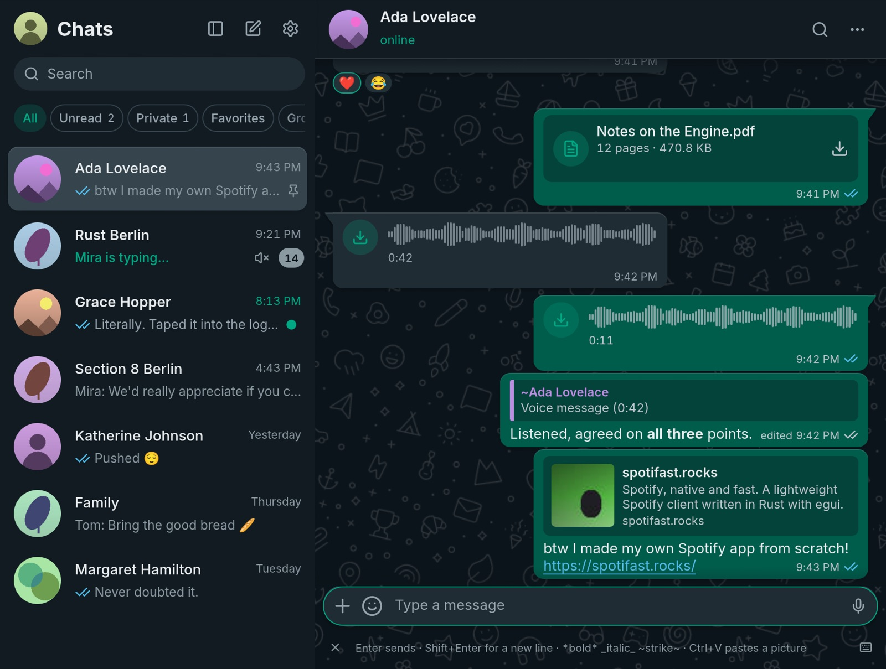</a></p>

| | Before: WhatsApp Desktop (Mac) | After: ZapFast |
|---|---|---|
| **Built with** | Mac Catalyst | Rust · egui · whatsapp-rust |
| **Download** | [~289 MB download, ~511 MB installed](https://web.whatsapp.com/desktop/mac_native/release/?version=2.26.40.20&extension=zip&configuration=Release&branch=master&is_buck=true) | Not published |
| **Memory** | [232 MB idle, 268 MB with 10 chats open](https://www.genbeta.com/mensajeria-instantanea/whatsapp-llevaba-anos-secuestrando-nuestros-mac-pc-windows-10-11-fin-han-solucionado)<br><sub>Mac Catalyst beta, macOS Ventura, Activity Monitor, 2023-01-24</sub> | [~200 MB (vs 1.13 GB for WhatsApp Web)](https://github.com/crmne/zapfast#readme) (Linux) |
| **Startup time** | n/a | [<1 s](https://github.com/crmne/zapfast#readme) (Linux) |
| **Runs on** | Any Mac | Not stated |

**Why switch:** No browser engine, links as a companion device · Themeable, with app lock and keyboard shortcuts · Universal macOS DMG and Homebrew cask  
**Watch out:** Unofficial client, may violate WhatsApp terms and risk suspension · Benchmarks are Linux-only · Some WhatsApp features not yet supported  
**Status:** Actively developed, latest release `v0.19.0` (2026-10-03)

### Make Slack Great Again (msga)

🟢 **Native** · Native rewrite · replaces **Slack** · [`punarinta/make-slack-great-again`](https://github.com/punarinta/make-slack-great-again)

  

Slack client written from scratch in C++ with its own renderer and networking: no Electron, no web view, no GUI toolkit.

<p><a href="https://github.com/punarinta/make-slack-great-again">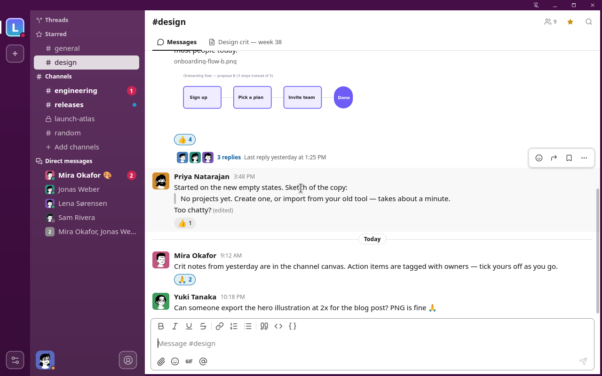</a></p>

| | Before: Slack | After: Make Slack Great Again (msga) |
|---|---|---|
| **Built with** | Electron | C++20 · custom CPU renderer · AppKit/Win32/Wayland adapters |
| **Download** | [~124 MB download, ~518 MB installed](https://downloads.slack-edge.com/desktop-releases/mac/arm64/4.52.178/Slack-4.52.178-macOS.dmg) | [2.2 MB DMG](https://github.com/punarinta/make-slack-great-again#readme) |
| **Memory** | [~130 MB to ~960 MB per workspace](https://slack.engineering/reducing-slacks-memory-footprint/)<br><sub>per signed-in team, p10 to p99, each team in its own webview (pre-2019 architecture), 2017-03</sub> | Not published |
| **Runs on** | Any Mac | macOS 14+, Apple Silicon only |

**Why switch:** Starts instantly, single self-contained file · Sign in through your browser, no Slack app or tokens needed · Claude Code sessions in the same workspace rail  
**Watch out:** Not notarized, needs Open Anyway on first launch · Session sign-in polls instead of live push · macOS build is Apple Silicon only  
**Status:** Actively developed, latest release `2026-10-10` (2026-10-10)

### Swiftcord

🟢 **Native** · SwiftUI · replaces **Discord** · [`SwiftcordApp/Swiftcord`](https://github.com/SwiftcordApp/Swiftcord)

 

100% SwiftUI Discord client for Mac and iPad that uses system controls instead of a web shell.

<p><a href="https://github.com/SwiftcordApp/Swiftcord">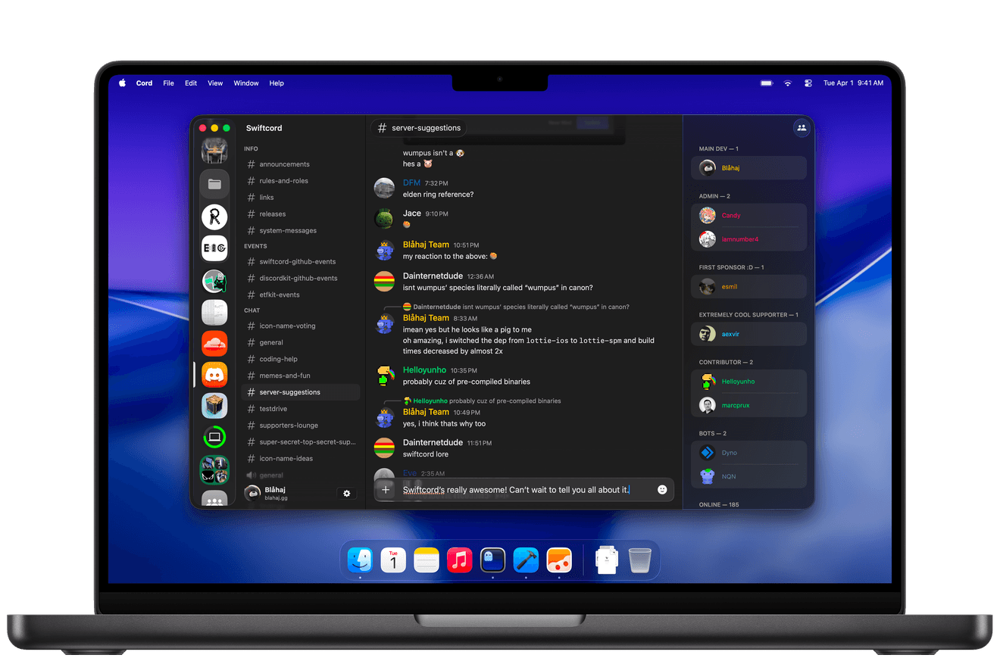</a></p>

| | Before: Discord | After: Swiftcord |
|---|---|---|
| **Built with** | Electron | Swift · SwiftUI |
| **Download** | [~215 MB download, ~837 MB installed](https://dl.discordapp.net/apps/osx/0.0.415/Discord.dmg) | Not published |
| **Memory** | [<1 GB normal, auto-restart experiment above 4 GB](https://old.reddit.com/r/discordapp/comments/1pej7l7/restart_on_excessive_memory_usage_experiment/)<br><sub>Discord employee statement on Windows client memory, 2025-12</sub> | Not published |
| **Runs on** | Any Mac | macOS 26+, Apple Silicon only |

**Why switch:** Uses system controls and Liquid Glass · Launches instantly and moves quickly between conversations · Mac and iPad support  
**Watch out:** Requires macOS 26 and Apple Silicon · Current v2 branch has no source code, legacy GPL code is archived on main · GitHub releases only cover the legacy 2023 build  
**Status:** Active (v2 distributed from swiftcord.app), latest release `v0.7.1` (2023-11-09)

### SakuraCord

🟢 **Native** · SwiftUI · replaces **Discord** · [`SakuraCordApp/SakuraCord`](https://github.com/SakuraCordApp/SakuraCord)

  

SwiftUI Discord client that keeps Discord's familiar layout but behaves like a native Mac app, including voice and video.

<p><a href="https://github.com/SakuraCordApp/SakuraCord">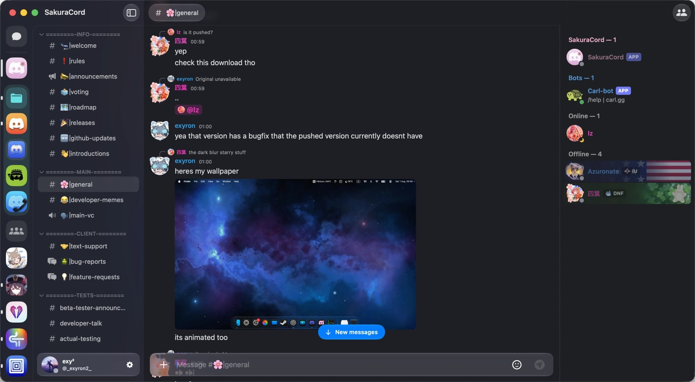</a></p>

| | Before: Discord | After: SakuraCord |
|---|---|---|
| **Built with** | Electron | Swift 6.4 · SwiftUI · AppKit · Metal |
| **Download** | [~215 MB download, ~837 MB installed](https://dl.discordapp.net/apps/osx/0.0.415/Discord.dmg) | Not published |
| **Memory** | [<1 GB normal, auto-restart experiment above 4 GB](https://old.reddit.com/r/discordapp/comments/1pej7l7/restart_on_excessive_memory_usage_experiment/)<br><sub>Discord employee statement on Windows client memory, 2025-12</sub> | Not published |
| **Runs on** | Any Mac | macOS 27+, Apple Silicon only |

**Why switch:** Real macOS windows, menus, shortcuts and Liquid Glass · Voice and video calls with native device controls · Rich Discord content: embeds, stickers, slash commands  
**Watch out:** Requires macOS 27 · Ad-hoc signed, not notarized · Unofficial client, compatibility can break as Discord changes  
**Status:** Young, active, latest release `v0.1.6` (2026-10-08)

### WhatsApp Desk

🟡 **Hybrid** · Native shell + WebView · replaces **WhatsApp Desktop (Mac)** · [`vianziro/Whatsapp-Dekstop`](https://github.com/vianziro/Whatsapp-Dekstop)

  

Thin Go wrapper that runs WhatsApp Web in the system WebKit view instead of bundling Chromium.

<p><a href="https://github.com/vianziro/Whatsapp-Dekstop">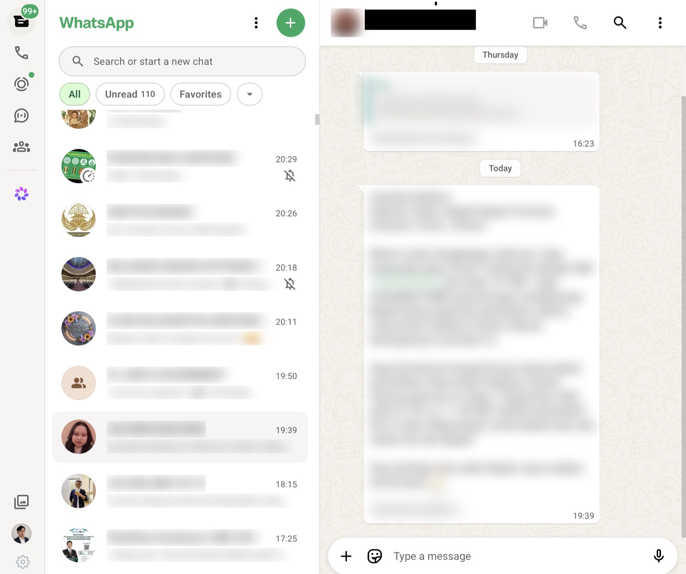</a></p>

| | Before: WhatsApp Desktop (Mac) | After: WhatsApp Desk |
|---|---|---|
| **Built with** | Mac Catalyst | Go · system WebKit (macOS) / WebView2 / WebKitGTK |
| **Download** | [~289 MB download, ~511 MB installed](https://web.whatsapp.com/desktop/mac_native/release/?version=2.26.40.20&extension=zip&configuration=Release&branch=master&is_buck=true) | Not published |
| **Memory** | [232 MB idle, 268 MB with 10 chats open](https://www.genbeta.com/mensajeria-instantanea/whatsapp-llevaba-anos-secuestrando-nuestros-mac-pc-windows-10-11-fin-han-solucionado)<br><sub>Mac Catalyst beta, macOS Ventura, Activity Monitor, 2023-01-24</sub> | [~100 MB (app process only)](https://github.com/vianziro/Whatsapp-Dekstop#readme) (Cross-platform) |
| **Runs on** | Any Mac | macOS 12+ |

**Why switch:** Two WhatsApp accounts in one window · Privacy mode and auto-lock shortcut · Frees WebView memory after being hidden 15 minutes  
**Watch out:** Still WhatsApp Web inside a system webview, not a native rewrite · Unsigned binaries, Gatekeeper prompt on first launch · Web renderer memory not included in the 100 MB figure  
**Status:** New, active, latest release `v1.6.3` (2026-10-04)

### Discordo

⌨️ **Terminal** · Terminal UI · replaces **Discord** · [`ayn2op/discordo`](https://github.com/ayn2op/discordo)

  

Lightweight Discord client for the terminal, with guild trees, mentions and keybindings all in a TUI.

<p><a href="https://github.com/ayn2op/discordo">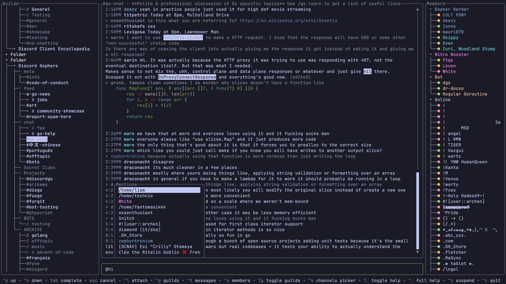</a></p>

| | Before: Discord | After: Discordo |
|---|---|---|
| **Built with** | Electron | Go · terminal UI |
| **Download** | [~215 MB download, ~837 MB installed](https://dl.discordapp.net/apps/osx/0.0.415/Discord.dmg) | Not published |
| **Memory** | [<1 GB normal, auto-restart experiment above 4 GB](https://old.reddit.com/r/discordapp/comments/1pej7l7/restart_on_excessive_memory_usage_experiment/)<br><sub>Discord employee statement on Windows client memory, 2025-12</sub> | Not published |
| **Runs on** | Any Mac | Not stated |

**Why switch:** Keyboard-driven navigation with configurable keybindings · Password, QR code or token login · Themeable via a TOML config  
**Watch out:** Terminal UI, not a graphical Mac app · Unofficial clients and self-bots are against Discord's terms · No tagged releases, binaries come from nightly CI  
**Status:** Established, active

### Ice Cubes

🟢 **Native** · SwiftUI · replaces **Mastodon (web)** · [`Dimillian/IceCubesApp`](https://github.com/Dimillian/IceCubesApp)

  

Multiplatform SwiftUI Mastodon client with a Mac sidebar, multi-account switching and live timelines.

<p><a href="https://github.com/Dimillian/IceCubesApp">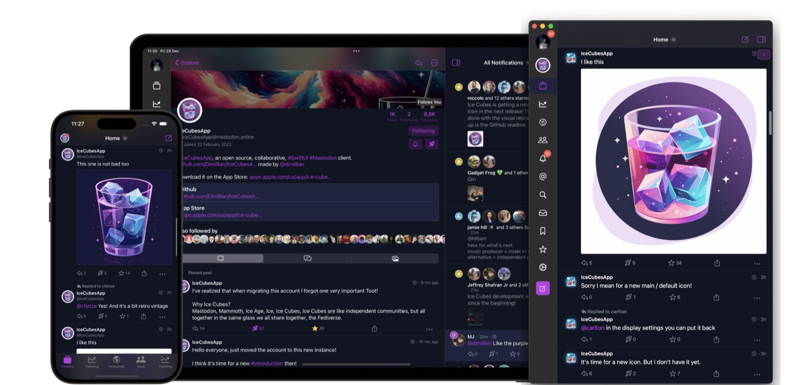</a></p>

| | Before: Mastodon (web) | After: Ice Cubes |
|---|---|---|
| **Built with** | Browser tab | Swift · SwiftUI |
| **Download** | Not published | Not published |
| **Memory** | Not published | Not published |
| **Runs on** | Any Mac | Not stated |

**Why switch:** Dedicated sidebar layout on macOS · Unlimited accounts, switch from the sidebar in one click · Live streaming timeline with synced position across devices  
**Watch out:** Mastodon is an open protocol, so this is an alternative client rather than a rewrite of a closed app · Mac version distributed through the App Store  
**Status:** Established, active, latest release `2.1.4` (2026-10-08)

### Mactrix

🟢 **Native** · SwiftUI · replaces **Element Desktop** · [`viktorstrate/mactrix`](https://github.com/viktorstrate/mactrix)

  

SwiftUI Matrix client for macOS built on matrix-rust-sdk for protocol and encryption.

<p><a href="https://github.com/viktorstrate/mactrix">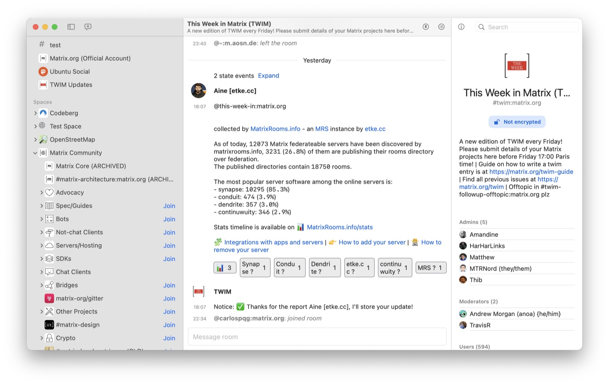</a></p>

| | Before: Element Desktop | After: Mactrix |
|---|---|---|
| **Built with** | Electron | Swift · SwiftUI · matrix-rust-sdk |
| **Download** | [~280 MB download, ~1.1 GB installed](https://packages.element.io/desktop/update/macos/Element-1.12.30-universal-mac.zip) | Not published |
| **Memory** | [V8 heap idling ~1.3 GB (1.1 GB after GC)](https://github.com/element-hq/element-web/issues/25264)<br><sub>Matrix project lead (ara4n) diagnosing his own long-lived account; expected ~500 MB, 2023-05-02</sub> | Not published |
| **Runs on** | Any Mac | macOS 15.7+ |

**Why switch:** Native macOS three-pane layout · Threads, spaces, multiple windows and tabs · Emoji device verification  
**Watch out:** Early development, many features incomplete · No auto-updating distribution yet · No voice or video chat  
**Status:** Early development, latest release `v0.4.0` (2026-09-23)

### Nheko

🟢 **Native** · Qt · replaces **Element Desktop** · [`Nheko-Reborn/nheko`](https://github.com/Nheko-Reborn/nheko)

  

Qt and C++ Matrix desktop client with encryption, calls and a room switcher, an alternative to Element.

<p><a href="https://github.com/Nheko-Reborn/nheko">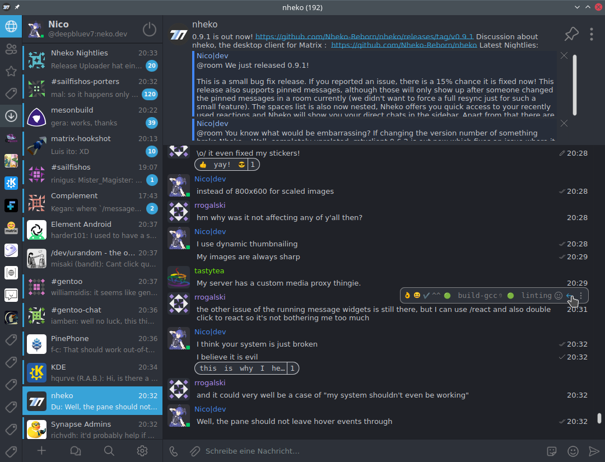</a></p>

| | Before: Element Desktop | After: Nheko |
|---|---|---|
| **Built with** | Electron | C++20 · Qt |
| **Download** | [~280 MB download, ~1.1 GB installed](https://packages.element.io/desktop/update/macos/Element-1.12.30-universal-mac.zip) | Not published |
| **Memory** | [V8 heap idling ~1.3 GB (1.1 GB after GC)](https://github.com/element-hq/element-web/issues/25264)<br><sub>Matrix project lead (ara4n) diagnosing his own long-lived account; expected ~500 MB, 2023-05-02</sub> | Not published |
| **Runs on** | Any Mac | macOS 10.14+ |

**Why switch:** Feels like a mainstream chat app rather than an IRC client · E2E encryption and VoIP calls · Ctrl-K room switcher  
**Watch out:** E2E encryption implementation never audited · Qt UI, not Apple-native · Last stable release August 2025  
**Status:** Established, maintained, latest release `v0.12.1` (2025-08-10)

### Hacker News

🟢 **Native** · SwiftUI · replaces **Hacker News website** · [`IronsideXXVI/Hacker-News`](https://github.com/IronsideXXVI/Hacker-News)

  

SwiftUI Mac app for Hacker News with a story grid, in-app article reader and threaded comments.

<p><a href="https://github.com/IronsideXXVI/Hacker-News">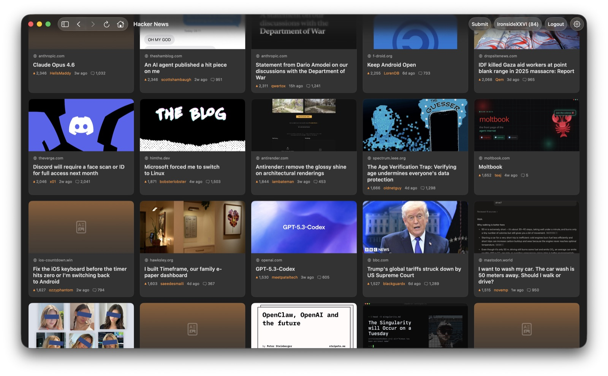</a></p>

| | Before: Hacker News website | After: Hacker News |
|---|---|---|
| **Built with** | Website | Swift · SwiftUI · Sparkle |
| **Download** | Not published | Not published |
| **Memory** | Not published | Not published |
| **Runs on** | Any Mac | macOS 14+ |

**Why switch:** Story grid with article previews · Built-in article and threaded comment views · Sparkle auto-updates  
**Watch out:** Read-focused site client, not a service rewrite · Small project, last release February 2026  
**Status:** Maintained, modest community, latest release `v1.8.5` (2026-02-27)

### Chatterino

🟢 **Native** · Qt · replaces **Twitch (web chat)** · [`Chatterino/chatterino2`](https://github.com/Chatterino/chatterino2)

  

Qt chat client for Twitch that puts many channels in tabs and split panes, outside the browser.

<p><a href="https://github.com/Chatterino/chatterino2">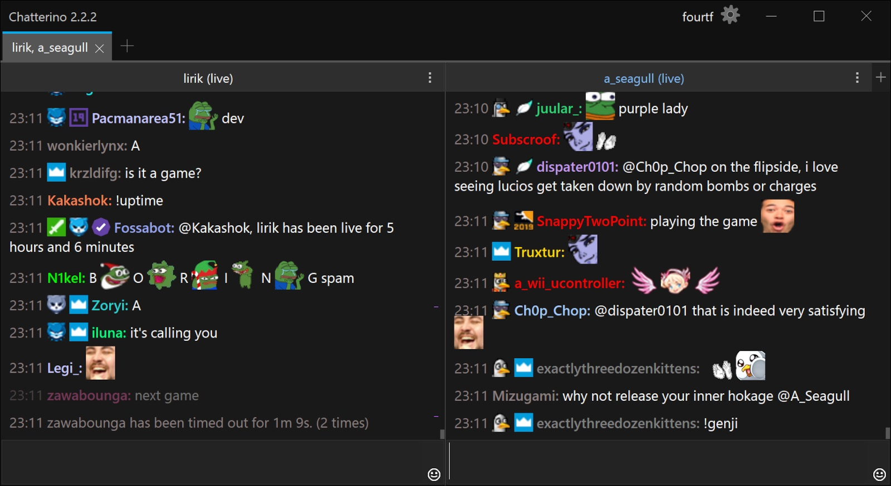</a></p>

| | Before: Twitch (web chat) | After: Chatterino |
|---|---|---|
| **Built with** | Browser tab | C++ · Qt |
| **Download** | Not published | Not published |
| **Memory** | Not published | Not published |
| **Runs on** | Any Mac | Not stated |

**Why switch:** Multiple channels in tabs and split panes · Native Qt desktop app, no browser tab · Cross-platform: macOS, Windows, Linux, FreeBSD  
**Watch out:** Chat only, no stream video · README has no macOS version requirement  
**Status:** Established / active, latest release `v2.5.6` (2026-10-04)

---

## Music, Video and Streaming

Your music player should not need more memory than the game you are playing while it runs.

### Spotifast

🟢 **Native** · Native rewrite · replaces **Spotify** · [`crmne/spotifast`](https://github.com/crmne/spotifast)

  

Rust and egui Spotify client that plays through librespot with no browser engine and a Winamp-style mini player.

<p><a href="https://github.com/crmne/spotifast">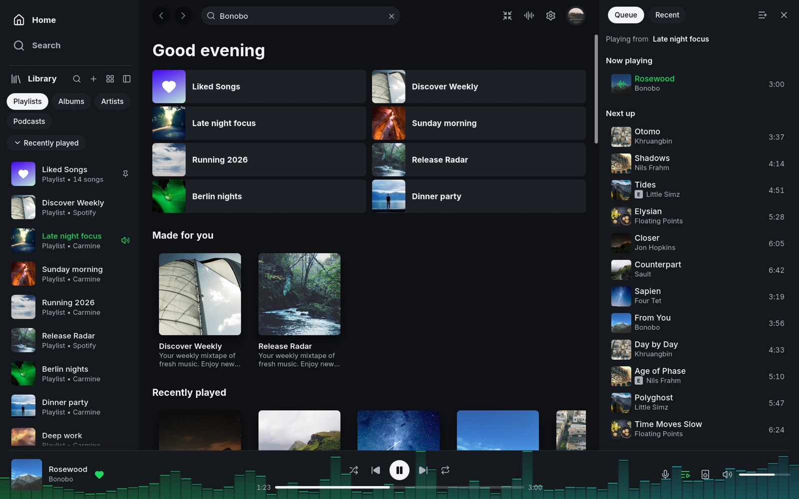</a></p>

| | Before: Spotify | After: Spotifast |
|---|---|---|
| **Built with** | CEF | Rust · egui · librespot |
| **Download** | [~174 MB download, ~623 MB installed](https://download.scdn.co/SpotifyARM64.dmg) | Not published |
| **Memory** | [~185 MB at startup, 700+ MB after interaction](https://linuxlinks.com/streaming-linux-spotify)<br><sub>Linux client review, 2022-09-14</sub> | [100–250 MB](https://github.com/crmne/spotifast#readme) |
| **Startup time** | n/a | [<1 s](https://github.com/crmne/spotifast#readme) |
| **Runs on** | Any Mac | Not stated |

**Why switch:** Subsecond startup · Spotify Connect and media keys · Winamp mini player and MilkDrop visuals  
**Watch out:** Playback needs Spotify Premium · Unofficial librespot access can break  
**Status:** Popular / active, latest release `v0.12.0` (2026-10-03)

### Psst

🟢 **Native** · Native rewrite · replaces **Spotify** · [`jpochyla/psst`](https://github.com/jpochyla/psst)

  

Fast Rust Spotify client with a native Druid GUI, no Electron, and its own playback core.

<p><a href="https://github.com/jpochyla/psst">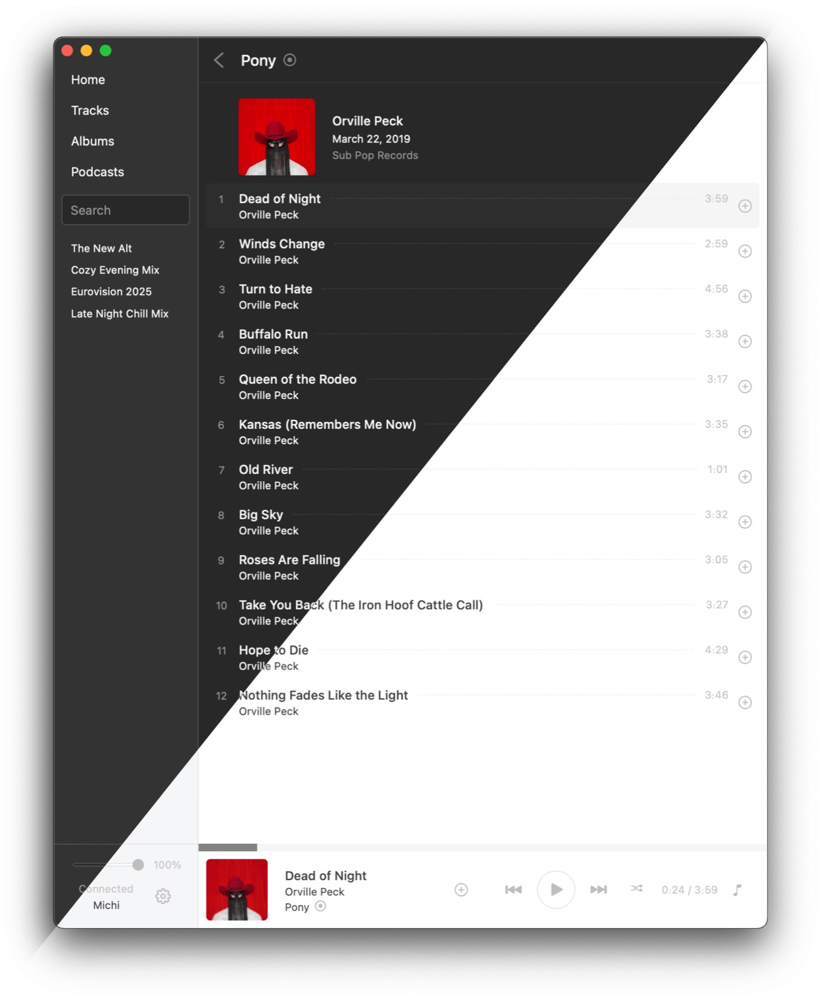</a></p>

| | Before: Spotify | After: Psst |
|---|---|---|
| **Built with** | CEF | Rust · Druid · librespot-derived core |
| **Download** | [~174 MB download, ~623 MB installed](https://download.scdn.co/SpotifyARM64.dmg) | Not published |
| **Memory** | [~185 MB at startup, 700+ MB after interaction](https://linuxlinks.com/streaming-linux-spotify)<br><sub>Linux client review, 2022-09-14</sub> | Not published |
| **Runs on** | Any Mac | Not stated |

**Why switch:** Native GUI without Electron · Dark and light themes · Does not call home  
**Watch out:** Premium required · Needs your own Spotify Developer Client ID since Feb 2026 · README says early, lacking features and stability  
**Status:** Popular / early, slowing, latest release `rolling` (2025-06-28)

### spotify-qt

🟢 **Native** · Qt · replaces **Spotify** · [`kraxarn/spotify-qt`](https://github.com/kraxarn/spotify-qt)

  

Lightweight Qt front end for Spotify that controls a separate playback backend like librespot.

<p><a href="https://github.com/kraxarn/spotify-qt">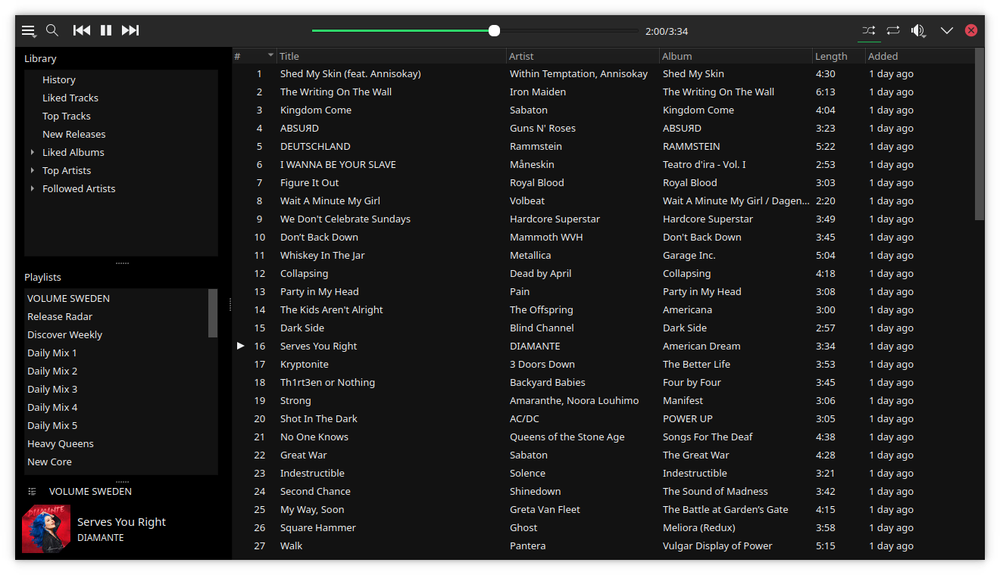</a></p>

| | Before: Spotify | After: spotify-qt |
|---|---|---|
| **Built with** | CEF | C++ · Qt 6 · external librespot backend |
| **Download** | [~174 MB download, ~623 MB installed](https://download.scdn.co/SpotifyARM64.dmg) | Not published |
| **Memory** | [~185 MB at startup, 700+ MB after interaction](https://linuxlinks.com/streaming-linux-spotify)<br><sub>Linux client review, 2022-09-14</sub> | Not published |
| **Runs on** | Any Mac | macOS 13+ |

**Why switch:** Simple, lighter Qt interface · Customizable · Small file size is a stated goal  
**Watch out:** Needs a separate Spotify client such as librespot for playback · Controlling playback requires Premium · Not aiming for feature parity  
**Status:** Established / active, latest release `v4.0.4` (2026-05-01)

### Spotifust

🟢 **Native** · GPU-rendered · replaces **Spotify** · [`gefydev/spotifust`](https://github.com/gefydev/spotifust)

  

Single-process Rust Spotify client built on iced with embedded librespot playback.

| | Before: Spotify | After: Spotifust |
|---|---|---|
| **Built with** | CEF | Rust · iced · librespot · rspotify |
| **Download** | [~174 MB download, ~623 MB installed](https://download.scdn.co/SpotifyARM64.dmg) | Not published |
| **Memory** | [~185 MB at startup, 700+ MB after interaction](https://linuxlinks.com/streaming-linux-spotify)<br><sub>Linux client review, 2022-09-14</sub> | [<25 MB (target)](https://github.com/gefydev/spotifust#readme) |
| **Runs on** | Any Mac | Not stated |

**Why switch:** Single process, single binary · Draggable, resizable card layout · Credentials stored in OS keychain  
**Watch out:** Premium required · Tiny community, very early · RAM figure is a target, not a measurement  
**Status:** Early / active

### ncspot

⌨️ **Terminal** · Terminal UI · replaces **Spotify** · [`hrkfdn/ncspot`](https://github.com/hrkfdn/ncspot)

  

ncurses Spotify client in Rust with vim keys, inspired by MPD clients like ncmpc.

<p><a href="https://github.com/hrkfdn/ncspot">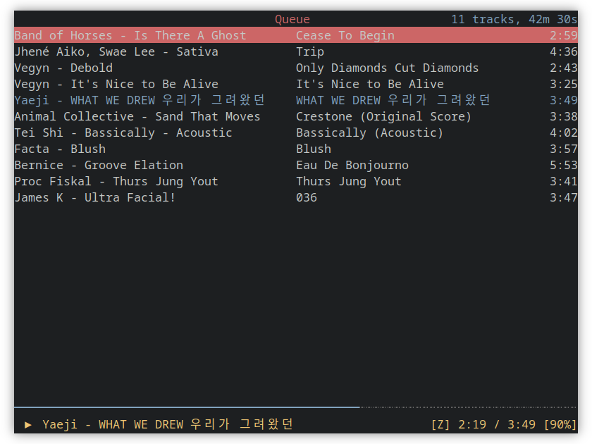</a></p>

| | Before: Spotify | After: ncspot |
|---|---|---|
| **Built with** | CEF | Rust · ncurses · librespot |
| **Download** | [~174 MB download, ~623 MB installed](https://download.scdn.co/SpotifyARM64.dmg) | Not published |
| **Memory** | [~185 MB at startup, 700+ MB after interaction](https://linuxlinks.com/streaming-linux-spotify)<br><sub>Linux client review, 2022-09-14</sub> | [46.2 MiB total (22.1 MiB private) vs 1000.0 MiB for official Spotify](https://github.com/hrkfdn/ncspot/blob/main/doc/resource_footprint.md) (Linux) |
| **Runs on** | Any Mac | Not stated |

**Why switch:** Vim keybindings out of the box · IPC socket for remote control · Small resource footprint  
**Watch out:** Premium only · Terminal UI, no artwork-driven browsing  
**Status:** Established / active, latest release `v1.5.0` (2026-10-01)

### spotify_player

⌨️ **Terminal** · Terminal UI · replaces **Spotify** · [`aome510/spotify-player`](https://github.com/aome510/spotify-player)

  

Configurable terminal Spotify player with streaming, Spotify Connect, lyrics and a daemon mode.

<p><a href="https://github.com/aome510/spotify-player">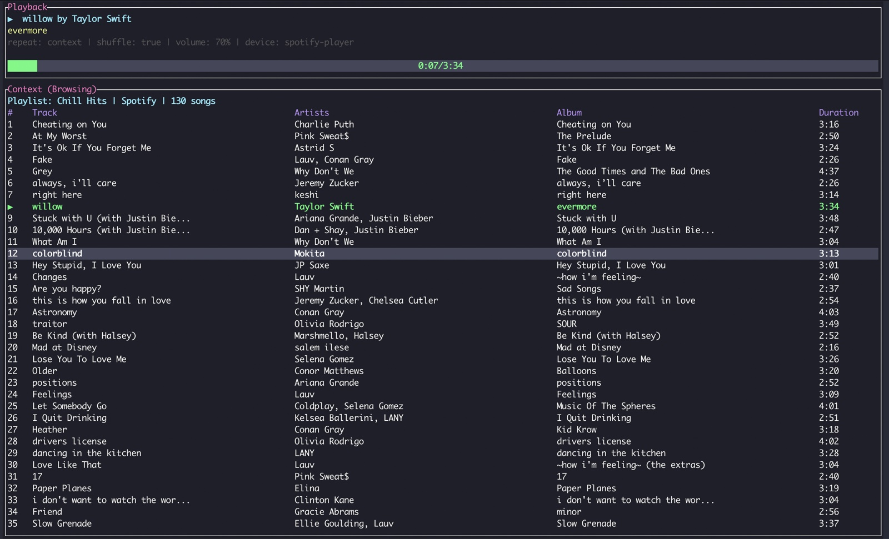</a></p>

| | Before: Spotify | After: spotify_player |
|---|---|---|
| **Built with** | CEF | Rust · ratatui · librespot · rspotify |
| **Download** | [~174 MB download, ~623 MB installed](https://download.scdn.co/SpotifyARM64.dmg) | Not published |
| **Memory** | [~185 MB at startup, 700+ MB after interaction](https://linuxlinks.com/streaming-linux-spotify)<br><sub>Linux client review, 2022-09-14</sub> | Not published |
| **Runs on** | Any Mac | Not stated |

**Why switch:** Spotify Connect and in-terminal streaming · Synced lyrics and audio visualization · Daemon mode and CLI commands  
**Watch out:** Premium required · Daemon mode on macOS needs media control disabled · Notifications limited on macOS  
**Status:** Established / active, latest release `v0.25.1` (2026-09-09)

### Spotiglass

🟡 **Hybrid** · Native shell + WebView · replaces **Spotify** · [`isaaclins/spotiglass`](https://github.com/isaaclins/spotiglass)

  -444?style=flat-square)

SwiftUI Spotify client for macOS 26 with a command palette, using a hidden WebView only for playback.

<p><a href="https://github.com/isaaclins/spotiglass">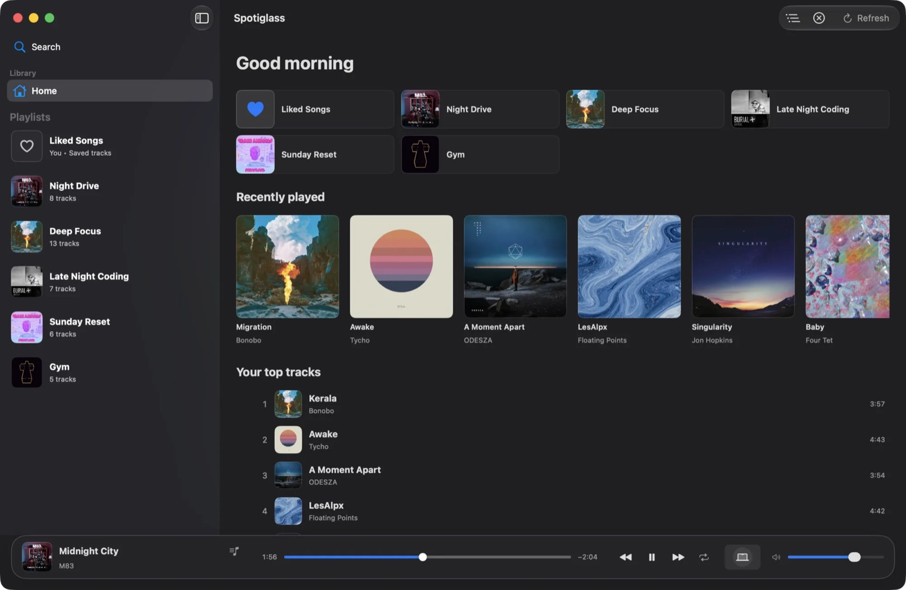</a></p>

| | Before: Spotify | After: Spotiglass |
|---|---|---|
| **Built with** | CEF | Swift · SwiftUI · Spotify Web API · Web Playback SDK (hidden WKWebView) |
| **Download** | [~174 MB download, ~623 MB installed](https://download.scdn.co/SpotifyARM64.dmg) | Not published |
| **Memory** | [~185 MB at startup, 700+ MB after interaction](https://linuxlinks.com/streaming-linux-spotify)<br><sub>Linux client review, 2022-09-14</sub> | Not published |
| **Runs on** | Any Mac | macOS 26+ |

**Why switch:** Command palette search (Cmd+K) · Remappable keyboard shortcuts · Equalizer and output device settings  
**Watch out:** Playback runs through Web Playback SDK in a hidden WKWebView · Needs your own Spotify Developer client ID and Premium · Non-commercial license, unsigned builds  
**Status:** Early / experimental, latest release `v0.7.0` (2026-08-16)

### Kaset

🟡 **Hybrid** · Native shell + WebView · replaces **YouTube Music (web)** · [`sozercan/kaset`](https://github.com/sozercan/kaset)

  

SwiftUI Mac app for YouTube Music and YouTube with native navigation, media controls and AppleScript.

<p><a href="https://github.com/sozercan/kaset">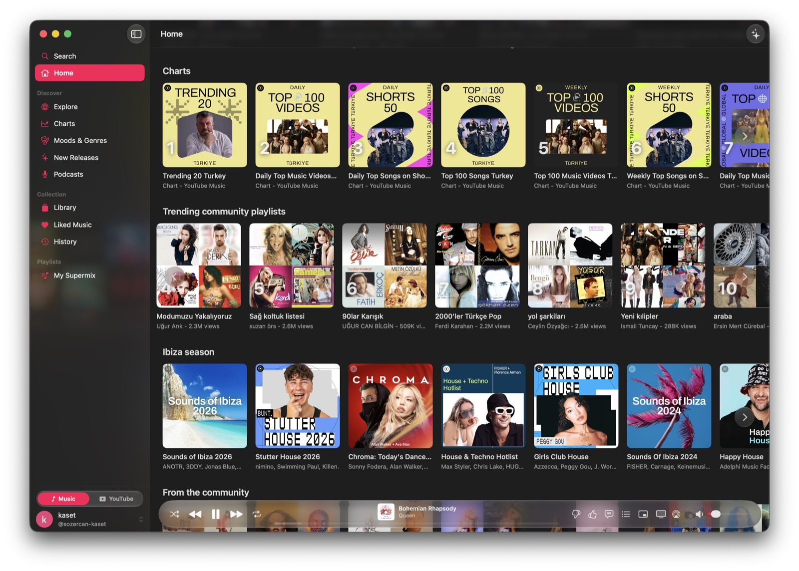</a></p>

| | Before: YouTube Music (web) | After: Kaset |
|---|---|---|
| **Built with** | Browser tab | Swift · SwiftUI · WebKit playback |
| **Download** | Not published | Not published |
| **Memory** | Not published | Not published |
| **Runs on** | Any Mac | macOS 15.4+ |

**Why switch:** Apple Music-style UI with Now Playing and media keys · AppleScript and URL scheme automation · Loads WebKit extensions like uBlock Origin Lite and SponsorBlock  
**Watch out:** Playback still goes through WebKit · Not signed or notarized · Apple Intelligence features need macOS 26  
**Status:** Popular / active, latest release `v0.14.1` (2026-09-24)

### SmartTube

🟢 **Native** · SwiftUI · replaces **YouTube (browser tab)** · [`milika/SmartTubeIOS`](https://github.com/milika/SmartTubeIOS)

  

Ad-free SwiftUI YouTube client for iPhone, iPad, Mac and Apple TV with SponsorBlock and DeArrow.

<p><a href="https://github.com/milika/SmartTubeIOS"></a></p>

| | Before: YouTube (browser tab) | After: SmartTube |
|---|---|---|
| **Built with** | Browser tab | Swift · SwiftUI · AVPlayer · Mac Catalyst |
| **Download** | Not published | Not published |
| **Memory** | [~470-530 MB RSS (~222-341 MB PSS)](https://www.superchargebrowser.com/library/chrome-ram-usage-per-tab-2026/)<br><sub>single 1080p video tab, Chromium 148/Chrome 149, clean profile, Linux smaps_rollup, 2026-06</sub> | Not published |
| **Runs on** | Any Mac | macOS 14+ |

**Why switch:** No ads, SponsorBlock auto-skip · DeArrow community titles and thumbnails · Up to 8K playback via AVPlayer  
**Watch out:** Mac version is Mac Catalyst · Relies on unofficial InnerTube API · Distributed via App Store, no GitHub releases  
**Status:** Active / growing

### Yattee

🟢 **Native** · SwiftUI · replaces **YouTube (browser tab)** · [`yattee/yattee`](https://github.com/yattee/yattee)

  

Privacy-focused SwiftUI video player for iOS, tvOS and macOS that watches YouTube through Invidious, Piped or a self-hosted yt-dlp server.

<p><a href="https://github.com/yattee/yattee">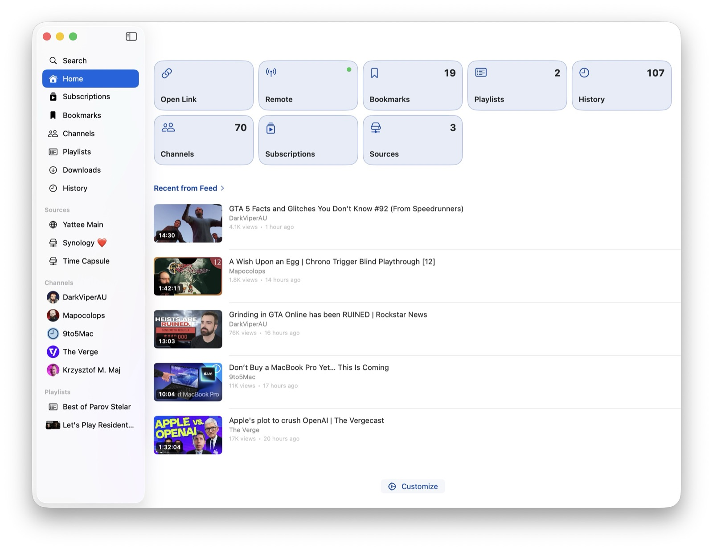</a></p>

| | Before: YouTube (browser tab) | After: Yattee |
|---|---|---|
| **Built with** | Browser tab | Swift · SwiftUI · Invidious/Piped/Yattee Server (yt-dlp) backends |
| **Download** | Not published | Not published |
| **Memory** | [~470-530 MB RSS (~222-341 MB PSS)](https://www.superchargebrowser.com/library/chrome-ram-usage-per-tab-2026/)<br><sub>single 1080p video tab, Chromium 148/Chrome 149, clean profile, Linux smaps_rollup, 2026-06</sub> | Not published |
| **Runs on** | Any Mac | macOS 15+ |

**Why switch:** Picture in Picture and background audio · SponsorBlock segment skipping · Player queue and history  
**Watch out:** Yattee 2 is beta-only (TestFlight or GitHub prereleases); last stable is v1.5.1 from 2024 · Needs an Invidious, Piped or self-hosted Yattee Server backend  
**Status:** Established, v2 in beta, latest release `v1.5.1` (2024-01-28)

### NativeYoutube

🟢 **Native** · SwiftUI · replaces **YouTube (browser tab)** · [`Aayush9029/NativeYoutube`](https://github.com/Aayush9029/NativeYoutube)

  

Lightweight macOS menu bar YouTube client for quick search, playback and playlists without opening a browser tab.

<p><a href="https://github.com/Aayush9029/NativeYoutube">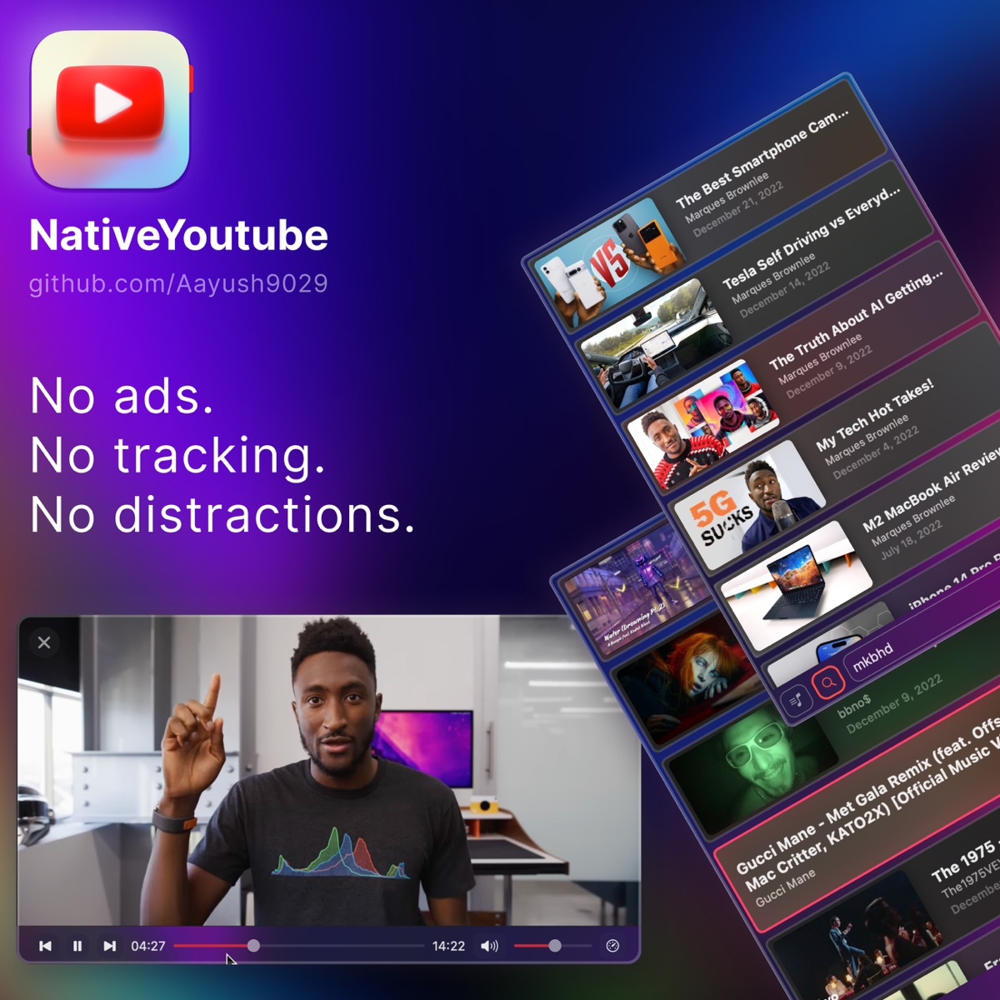</a></p>

| | Before: YouTube (browser tab) | After: NativeYoutube |
|---|---|---|
| **Built with** | Browser tab | Swift · SwiftUI · menu bar app · YouTube Data API |
| **Download** | Not published | Not published |
| **Memory** | [~470-530 MB RSS (~222-341 MB PSS)](https://www.superchargebrowser.com/library/chrome-ram-usage-per-tab-2026/)<br><sub>single 1080p video tab, Chromium 148/Chrome 149, clean profile, Linux smaps_rollup, 2026-06</sub> | Not published |
| **Runs on** | Any Mac | macOS 14+ |

**Why switch:** Lives in the menu bar, no browser tab · Quick search and playback · Custom playlist support  
**Watch out:** Requires your own YouTube Data API key · Menu bar utility, not a full YouTube replacement · Free with purchase reminders  
**Status:** Alpha, active, latest release `v3.2.7` (2026-09-12)

### YouTube X

🟡 **Hybrid** · Native shell + WebView · replaces **YouTube (browser tab)** · [`fizzygx/Youtube-X`](https://github.com/fizzygx/Youtube-X)

 

SwiftUI shell around YouTube in WKWebView that adds ad blocking, SponsorBlock and yt-dlp powered offline downloads.

<p><a href="https://github.com/fizzygx/Youtube-X">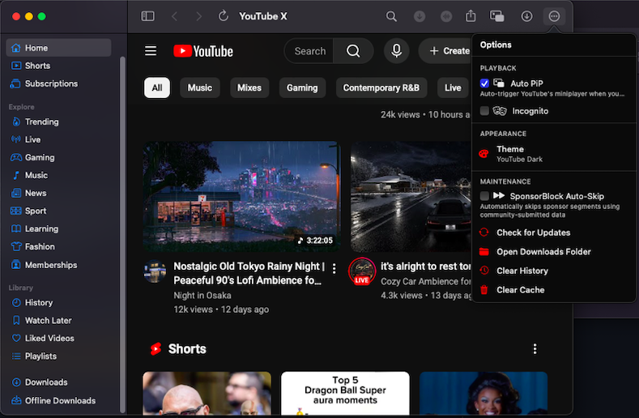</a></p>

| | Before: YouTube (browser tab) | After: YouTube X |
|---|---|---|
| **Built with** | Browser tab | Swift · SwiftUI · WKWebView · bundled yt-dlp + ffmpeg |
| **Download** | Not published | Not published |
| **Memory** | [~470-530 MB RSS (~222-341 MB PSS)](https://www.superchargebrowser.com/library/chrome-ram-usage-per-tab-2026/)<br><sub>single 1080p video tab, Chromium 148/Chrome 149, clean profile, Linux smaps_rollup, 2026-06</sub> | Not published |
| **Runs on** | Any Mac | macOS 13+ |

**Why switch:** Offline downloads of videos, Shorts and audio · Ad blocking plus optional SponsorBlock · Command palette and full keyboard shortcuts  
**Watch out:** UI is YouTube's website inside WKWebView, not a native rewrite · Unsigned build needs a Gatekeeper workaround · No license specified  
**Status:** Young, active, latest release `v2.0.3` (2026-08-20)

### HyperTube Music

🟢 **Native** · Qt · replaces **YouTube Music (web)** · [`hyper-tube/app`](https://github.com/hyper-tube/app)

  

Cross-platform YouTube Music client written in C++20 and Qt Quick, with no Electron and no bundled browser runtime.

<p><a href="https://github.com/hyper-tube/app">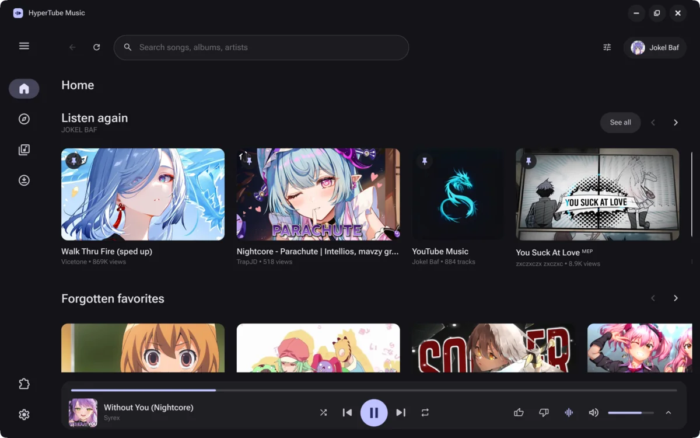</a></p>

| | Before: YouTube Music (web) | After: HyperTube Music |
|---|---|---|
| **Built with** | Browser tab | C++20 · Qt Quick |
| **Download** | Not published | Not published |
| **Memory** | Not published | Not published |
| **Runs on** | Any Mac | Not stated |

**Why switch:** No Electron or bundled browser runtime · Offline mode with smart downloads · Gapless playback, crossfade and equalizer  
**Watch out:** Very new project with few users · Extensive feature list is unverified · Screenshot shows a non-macOS window frame  
**Status:** Very early, active, latest release `v0.2.0` (2026-10-05)

### Riff

🟢 **Native** · SwiftUI · replaces **YouTube Music (web)** · [`thisizmvk/Riff`](https://github.com/thisizmvk/Riff)

  

SwiftUI YouTube Music client whose whole UI is native, using a hidden WebKit view only to play audio, including Premium tracks.

| | Before: YouTube Music (web) | After: Riff |
|---|---|---|
| **Built with** | Browser tab | Swift · SwiftUI · native InnerTube client · hidden WKWebView audio engine |
| **Download** | Not published | Not published |
| **Memory** | Not published | Not published |
| **Runs on** | Any Mac | macOS 14+ |

**Why switch:** Click any thumbnail to play · Floating always-on-top mini player · Synced lyrics and media key support  
**Watch out:** Audio plays through a hidden WKWebView · AI and Siri features are roadmap, not shipped · Minimal adoption, InnerTube changes may break it  
**Status:** Prototype, early, latest release `v0.1.0` (2026-05-05)

### Kumone

🟢 **Native** · SwiftUI · replaces **NetEase Cloud Music** · [`missuo/kumone`](https://github.com/missuo/kumone)

  

Native SwiftUI client for NetEase Cloud Music that talks straight to NetEase's API, with no webview and no third-party server.

<p><a href="https://github.com/missuo/kumone"></a></p>

| | Before: NetEase Cloud Music | After: Kumone |
|---|---|---|
| **Built with** | CEF | Swift 6 · SwiftUI · AVPlayer · native NetEase weapi/eapi client |
| **Download** | [~1.1 GB installed](https://desktopinsights.com/apps/neteasemusic) | Not published |
| **Memory** | Not published | Not published |
| **Runs on** | Any Mac | macOS 15+ |

**Why switch:** QR code login · Immersive now playing with synced lyrics and desktop lyrics · Notarized build with Sparkle auto-updates  
**Watch out:** Unofficial NetEase API integration · Playback depends on account region and licensing  
**Status:** Growing, active, latest release `v0.3.20` (2026-10-03)

### MeloX

🟢 **Native** · SwiftUI · replaces **NetEase Cloud Music** · [`youshen2/MeloX`](https://github.com/youshen2/MeloX)

  

SwiftUI NetEase Cloud Music client for iPhone, iPad, Mac and Apple Watch, styled after Apple Music with Liquid Glass.

<p><a href="https://github.com/youshen2/MeloX">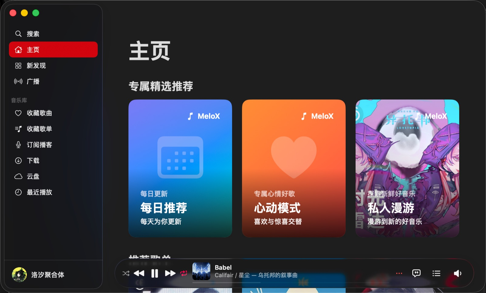</a></p>

| | Before: NetEase Cloud Music | After: MeloX |
|---|---|---|
| **Built with** | CEF | Swift · SwiftUI · Liquid Glass · Core ML (BeatNet) |
| **Download** | [~1.1 GB installed](https://desktopinsights.com/apps/neteasemusic) | Not published |
| **Memory** | Not published | Not published |
| **Runs on** | Any Mac | macOS 15+ |

**Why switch:** Apple Music style word-by-word lyrics · Mac sidebar with persistent bottom player · On-device smart automix  
**Watch out:** Service changes can break the unofficial API · GitHub DMGs are unsigned; signed builds only from the website · Apple Watch app still in development  
**Status:** Developing, active, latest release `v1.2.1` (2026-09-05)

### Moonfin

🔵 **Cross-platform** · Flutter · replaces **Jellyfin Media Player / Jellyfin web** · [`Moonfin-Client/Moonfin-Core`](https://github.com/Moonfin-Client/Moonfin-Core)

  

Flutter media client for Jellyfin and Emby servers that runs one codebase on phones, desktops, TVs and the web.

<p><a href="https://github.com/Moonfin-Client/Moonfin-Core">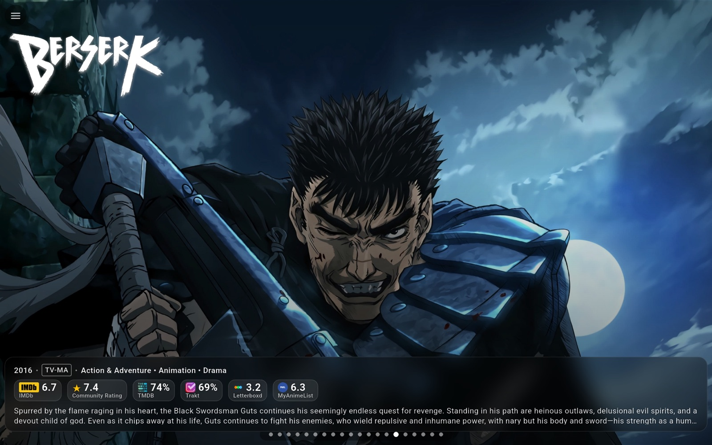</a></p>

| | Before: Jellyfin Media Player / Jellyfin web | After: Moonfin |
|---|---|---|
| **Built with** | Qt WebEngine | Dart · Flutter · mpv |
| **Download** | [~186 MB download, ~593 MB installed](https://github.com/jellyfin/jellyfin-media-player/releases/download/v1.12.0/JellyfinMediaPlayer-1.12.0-AppleSilicon.dmg) | Not published |
| **Memory** | [up to 4 GB](https://forum.jellyfin.org/t-jellyfin-media-player-very-slow-ui)<br><sub>browsing large libraries (1000+ items) in the JMP UI; same browsing smooth in a browser, 2025-06-08</sub> | Not published |
| **Runs on** | Any Mac | macOS 14+ |

**Why switch:** One codebase across phone, desktop, TV and web · Multi-server unified library · Offline downloads and wide codec support  
**Watch out:** Flutter, not native AppKit or SwiftUI · Requires a Jellyfin or Emby server  
**Status:** Active, growing, latest release `2.7.0` (2026-10-09)

### Amperfy

🟢 **Native** · SwiftUI · replaces **Ampache / Subsonic web players** · [`BLeeEZ/amperfy`](https://github.com/BLeeEZ/amperfy)

  

Swift music player for iOS, iPadOS and macOS that streams from your own Ampache or Subsonic server, with offline mode and gapless playback.

<p><a href="https://github.com/BLeeEZ/amperfy">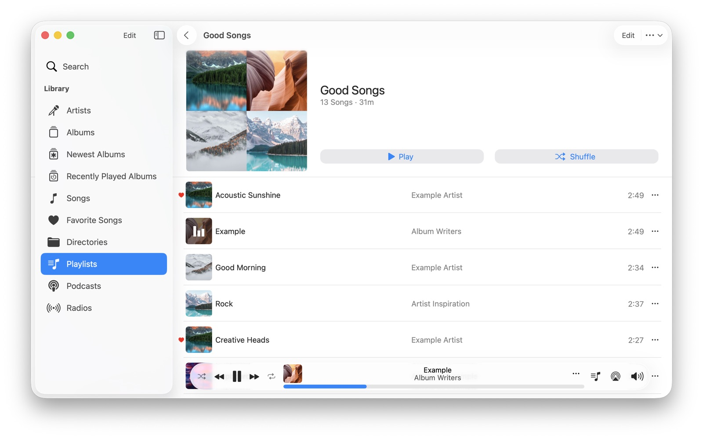</a></p>

| | Before: Ampache / Subsonic web players | After: Amperfy |
|---|---|---|
| **Built with** | Website | Swift 6 · UIKit + SwiftUI · Mac Catalyst |
| **Download** | Not published | Not published |
| **Memory** | Not published | Not published |
| **Runs on** | Any Mac | Not stated |

**Why switch:** Offline mode and gapless playback · Music, podcasts and radio in one app · On the Mac App Store  
**Watch out:** Requires an Ampache or Subsonic-compatible server · Mac version is a Catalyst port of the iOS app  
**Status:** Established, active, latest release `v2.1.1` (2026-08-13)

### Jellia

🟢 **Native** · SwiftUI · replaces **Jellyfin Media Player / Jellyfin web** · [`cjbars/jellia`](https://github.com/cjbars/jellia)

  

Native SwiftUI music client for Jellyfin on macOS, with AVFoundation playback that stays in sync with other Jellyfin clients.

<p><a href="https://github.com/cjbars/jellia">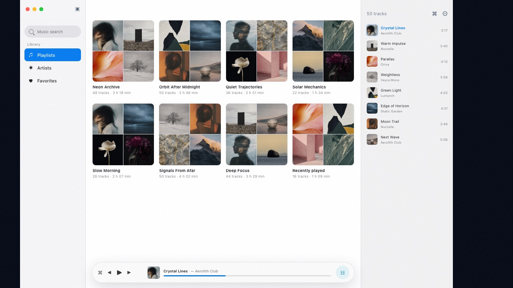</a></p>

| | Before: Jellyfin Media Player / Jellyfin web | After: Jellia |
|---|---|---|
| **Built with** | Qt WebEngine | Swift 6 · SwiftUI · AVFoundation |
| **Download** | [~186 MB download, ~593 MB installed](https://github.com/jellyfin/jellyfin-media-player/releases/download/v1.12.0/JellyfinMediaPlayer-1.12.0-AppleSilicon.dmg) | Not published |
| **Memory** | [up to 4 GB](https://forum.jellyfin.org/t-jellyfin-media-player-very-slow-ui)<br><sub>browsing large libraries (1000+ items) in the JMP UI; same browsing smooth in a browser, 2025-06-08</sub> | Not published |
| **Runs on** | Any Mac | macOS 26+ |

**Why switch:** No Electron and no web views · Now Playing and media key integration · Credentials stored in the macOS Keychain  
**Watch out:** Requires macOS 26 and a Jellyfin server · Unsigned builds need the quarantine flag cleared · README screenshots are mockups  
**Status:** Very early, active, latest release `v0.1.5` (2026-09-10)

### Jellybeam

🟢 **Native** · GPU-rendered · replaces **Jellyfin Media Player / Jellyfin web** · [`packetinspector/jellybeam-macos`](https://github.com/packetinspector/jellybeam-macos)

  

Jellyfin client for Apple Silicon Macs with a GPU-drawn Rust UI, libmpv playback and no web view anywhere.

| | Before: Jellyfin Media Player / Jellyfin web | After: Jellybeam |
|---|---|---|
| **Built with** | Qt WebEngine | Rust · GPUI (Metal) · libmpv · SQLite mirror |
| **Download** | [~186 MB download, ~593 MB installed](https://github.com/jellyfin/jellyfin-media-player/releases/download/v1.12.0/JellyfinMediaPlayer-1.12.0-AppleSilicon.dmg) | Not published |
| **Memory** | [up to 4 GB](https://forum.jellyfin.org/t-jellyfin-media-player-very-slow-ui)<br><sub>browsing large libraries (1000+ items) in the JMP UI; same browsing smooth in a browser, 2025-06-08</sub> | [< 250 MB browsing / < 500 MB playback (design budget)](https://github.com/packetinspector/jellybeam-macos/blob/HEAD/docs/OVERVIEW.md) |
| **Cold launch** | n/a | [< 500 ms (design budget)](https://github.com/packetinspector/jellybeam-macos/blob/HEAD/docs/OVERVIEW.md) |
| **Navigation latency** | n/a | [< 100 ms warm (design budget)](https://github.com/packetinspector/jellybeam-macos/blob/HEAD/docs/OVERVIEW.md) |
| **Search latency** | n/a | [< 50 ms (design budget)](https://github.com/packetinspector/jellybeam-macos/blob/HEAD/docs/OVERVIEW.md) |
| **Runs on** | Any Mac | macOS 11+, Apple Silicon only |

**Why switch:** Library browsing from a local SQLite mirror · Direct Play via libmpv with HDR/EDR output · Media keys, Now Playing, native fullscreen  
**Watch out:** Apple Silicon only · Releases not notarized · Tiny user base; budgets are targets, not benchmarks  
**Status:** Very early, active (v0.1.1, not notarized), latest release `v0.1.1` (2026-10-02)

### NetNewsWire

🟢 **Native** · AppKit · replaces **Feedly (web)** · [`Ranchero-Software/NetNewsWire`](https://github.com/Ranchero-Software/NetNewsWire)

  

Free, open source native feed reader for Mac and iOS, a fast three-pane replacement for Feedly in a browser tab.

<p><a href="https://github.com/Ranchero-Software/NetNewsWire">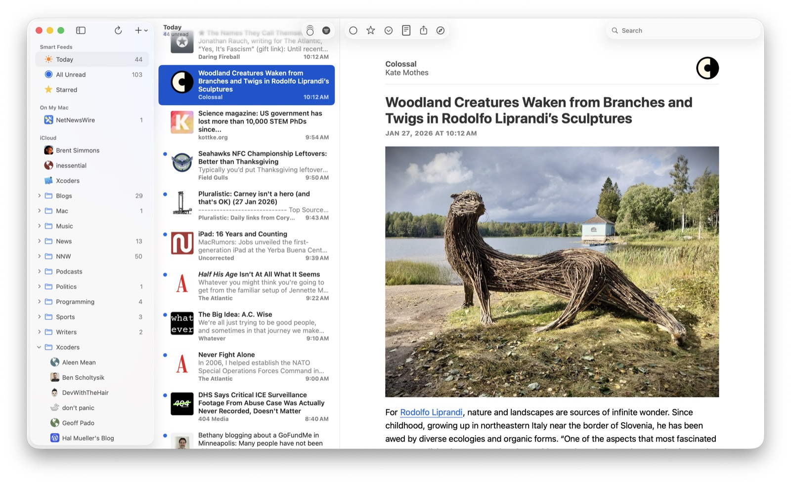</a></p>

| | Before: Feedly (web) | After: NetNewsWire |
|---|---|---|
| **Built with** | Browser tab | Swift · AppKit / UIKit |
| **Download** | Not published | Not published |
| **Memory** | Not published | Not published |
| **Runs on** | Any Mac | macOS 15+ |

**Why switch:** Classic three-pane native reader · Supports RSS, Atom, JSON Feed and RSS-in-JSON · Free, no ads, no account required  
**Watch out:** No AI summaries or feed intelligence like Feedly Pro · Sync depends on iCloud or a third-party service · macOS minimum taken from build settings, not stated in README  
**Status:** Mature / active, latest release `mac-7.1.5` (2026-09-29)

---

## Email and AI Workflows

Native mail and agent front ends for people who live in their inbox or their terminal.

### Postie

🟢 **Native** · SwiftUI · replaces **Gmail (web)** · [`igorkulman/Postie`](https://github.com/igorkulman/Postie)

  

Small SwiftUI Gmail client for macOS: no Electron, no subscription, no AI, talking straight to the Gmail API.

<p><a href="https://github.com/igorkulman/Postie">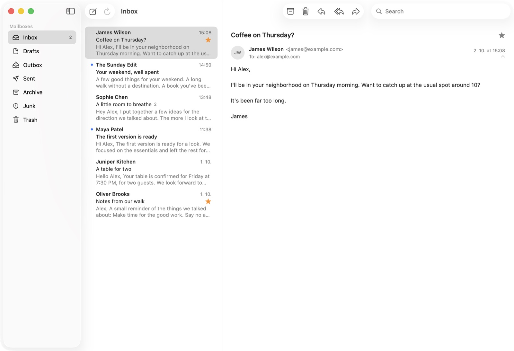</a></p>

| | Before: Gmail (web) | After: Postie |
|---|---|---|
| **Built with** | Browser tab | Swift · SwiftUI · Gmail API · SQLite cache |
| **Download** | Not published | Not published |
| **Memory** | [~350-450 MB RSS (~120-180 MB PSS)](https://www.superchargebrowser.com/library/chrome-ram-usage-per-tab-2026/)<br><sub>full inbox tab, Chromium 148/Chrome 149, clean profile, no extensions, 2026-06</sub> | Not published |
| **Runs on** | Any Mac | macOS 26+ |

**Why switch:** Multiple Gmail accounts merged into one set of folders · Search as you type with Gmail operators · Native light/dark mode and Dock unread badge  
**Watch out:** Gmail only, no IMAP · Unverified Google OAuth app (100-user limit) · Requires macOS 26  
**Status:** Early, active (signed and notarized releases), latest release `v0.2.0` (2026-10-09)

### Brev

🟢 **Native** · AppKit · replaces **Gmail (web)** · [`henrikogaard/brev`](https://github.com/henrikogaard/brev)

  

Local-first, telemetry-free mail client for macOS and iOS built on standard IMAP/SMTP plus the Gmail API.

<p><a href="https://github.com/henrikogaard/brev">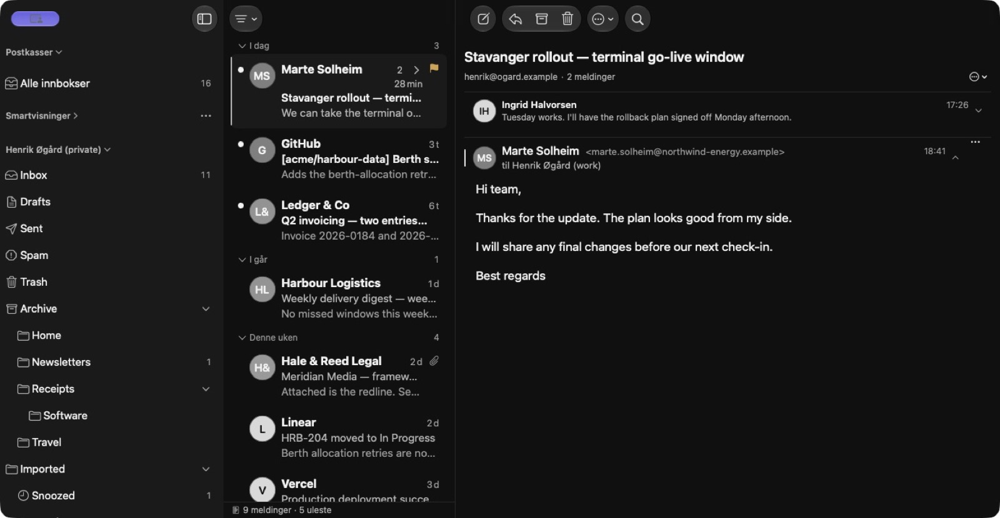</a></p>

| | Before: Gmail (web) | After: Brev |
|---|---|---|
| **Built with** | Browser tab | Swift · AppKit + SwiftUI · IMAP/SMTP · Gmail API |
| **Download** | Not published | Not published |
| **Memory** | [~350-450 MB RSS (~120-180 MB PSS)](https://www.superchargebrowser.com/library/chrome-ram-usage-per-tab-2026/)<br><sub>full inbox tab, Chromium 148/Chrome 149, clean profile, no extensions, 2026-06</sub> | Not published |
| **Runs on** | Any Mac | macOS 14+ |

**Why switch:** Real Mac app with menu bar, NSToolbar and shortcuts · 37 built-in themes plus JSON user themes · Zero telemetry, local-first  
**Watch out:** Pre-alpha, not ready for daily use · Real-provider QA still in progress · Screenshot is an internal QA capture of a demo mailbox  
**Status:** Pre-alpha per README (tagged pre-releases exist), latest release `v0.2.6` (2026-10-09)

### PowerUserMail

🟢 **Native** · SwiftUI · replaces **Superhuman** · [`isaaclins/powerusermail`](https://github.com/isaaclins/powerusermail)

  

Keyboard-first SwiftUI mail client with a Cmd+K palette, an open take on Superhuman-style workflows.

<p><a href="https://github.com/isaaclins/powerusermail">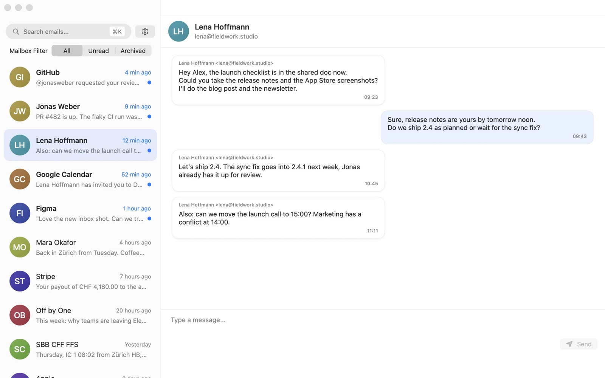</a></p>

| | Before: Superhuman | After: PowerUserMail |
|---|---|---|
| **Built with** | Electron | Swift · SwiftUI · command palette |
| **Download** | [~125 MB download, ~475 MB installed](https://storage.googleapis.com/download.superhuman.com/supertron-update/Superhuman-1041.0.69-arm64-latest-mac.zip) | Not published |
| **Memory** | Not published | Not published |
| **Runs on** | Any Mac | macOS 26+ |

**Why switch:** Cmd+K command palette for search and actions · Mail grouped into per-person conversations · Gmail, Outlook and IMAP accounts  
**Watch out:** Screenshots use a built-in demo mailbox · No release since Dec 2025 · Requires macOS 26 (Xcode deployment target)  
**Status:** Experimental (last tagged build Dec 2025), latest release `v2025.12.03-28` (2025-12-03)

### Clarc

🟢 **Native** · SwiftUI · replaces **Claude Code (CLI)** · [`ttnear/Clarc`](https://github.com/ttnear/Clarc)

  

SwiftUI desktop client for Claude Code that runs the real claude CLI underneath, so CLAUDE.md, skills and MCP keep working.

<p><a href="https://github.com/ttnear/Clarc">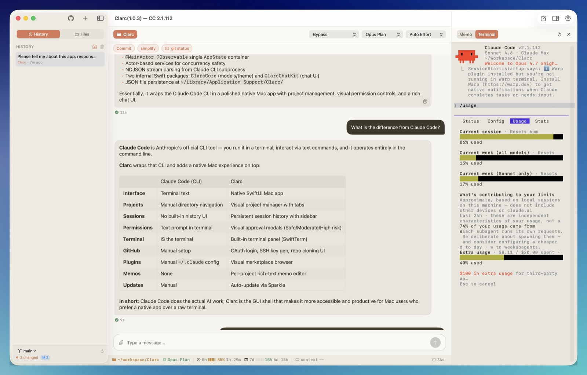</a></p>

| | Before: Claude Code (CLI) | After: Clarc |
|---|---|---|
| **Built with** | TypeScript + React Ink TUI | Swift · SwiftUI · SwiftTerm · wraps official claude CLI |
| **Download** | [~228 MB binary](https://downloads.claude.ai/claude-code-releases/2.1.287/darwin-arm64/claude) | [~6 MB download / ~14 MB unpacked](https://github.com/ttnear/Clarc#readme) |
| **Memory** | [~700 MB RSS per idle instance](https://github.com/anthropics/claude-code/issues/61425)<br><sub>Linux, two sessions ~1.4 GiB total (ps output shows ~370-500 MB RSS), 2026-05-22</sub> | Not published |
| **Runs on** | Any Mac | macOS 15+ |

**Why switch:** Diff preview in permission prompts before tools run · Per-project windows with background streams · Built-in file tree, Git status and terminal  
**Watch out:** Requires Claude Code CLI installed and authenticated · Not a Claude.ai desktop replacement · GitHub API reports no license (README says Apache-2.0)  
**Status:** Active, niche (signed and notarized, Homebrew cask), latest release `v1.4.1` (2026-08-20)

---

## Editors, Terminals and Developer Tools

Not always a client for the same service, but a faster replacement for the same job.

### Zed

🟢 **Native** · GPU-rendered · replaces **Visual Studio Code** · [`zed-industries/zed`](https://github.com/zed-industries/zed)

  

Rust code editor from the creators of Atom and Tree-sitter, drawn on the GPU by its own GPUI framework.

<p><a href="https://github.com/zed-industries/zed">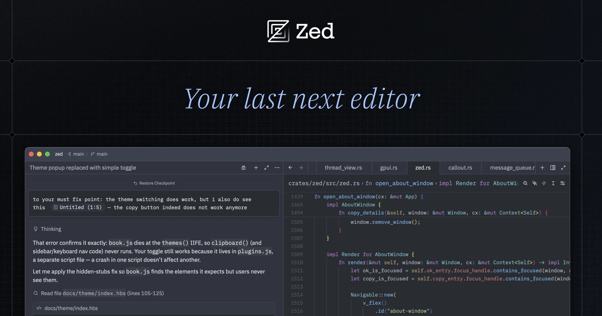</a></p>

| | Before: Visual Studio Code | After: Zed |
|---|---|---|
| **Built with** | Electron | Rust · GPUI (Metal on macOS) |
| **Download** | [~329 MB download, ~987 MB installed](https://update.code.visualstudio.com/1.141.0/darwin-arm64/stable) | Not published |
| **Memory** | [3-4 GB+](https://zed.dev/compare/vscode)<br><sub>with many extensions; competitor (Zed) comparison page, 2026-05-01</sub> | Not published |
| **Frame rate** | n/a | [120 FPS rendering target](https://zed.dev/blog/videogame) |
| **Runs on** | Any Mac | macOS 12+ |

**Why switch:** GPU-rendered UI built for responsiveness · Built-in multiplayer collaboration · Integrated AI agent panel  
**Watch out:** Extension ecosystem smaller than VS Code · Mixed licensing (GPL-3.0-or-later plus Apache-2.0 parts) · macOS 10.15 and 11 only partially supported  
**Status:** Mature, very popular, latest release `v1.23.2` (2026-10-07)

### CodeEdit

🟢 **Native** · SwiftUI · replaces **Visual Studio Code** · [`CodeEditApp/CodeEdit`](https://github.com/CodeEditApp/CodeEdit)

  

Community-built code editor written entirely for macOS, aiming for TextEdit lightness that scales up toward Xcode.

<p><a href="https://github.com/CodeEditApp/CodeEdit">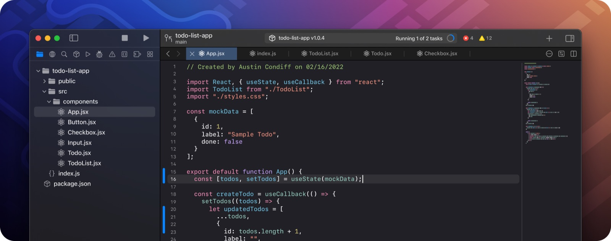</a></p>

| | Before: Visual Studio Code | After: CodeEdit |
|---|---|---|
| **Built with** | Electron | Swift · AppKit + SwiftUI |
| **Download** | [~329 MB download, ~987 MB installed](https://update.code.visualstudio.com/1.141.0/darwin-arm64/stable) | Not published |
| **Memory** | [3-4 GB+](https://zed.dev/compare/vscode)<br><sub>with many extensions; competitor (Zed) comparison page, 2026-05-01</sub> | Not published |
| **Runs on** | Any Mac | macOS 14+ |

**Why switch:** Mac-only design following Apple HIG · Xcode-like feel for non-Apple projects · Free and open source forever  
**Watch out:** Not yet recommended for production use · No tagged release since Aug 2025 · Far smaller extension ecosystem than VS Code  
**Status:** Pre-release, not recommended for production (per README), latest release `v0.3.6` (2025-08-26)

### Lapce

🟢 **Native** · GPU-rendered · replaces **Visual Studio Code** · [`lapce/lapce`](https://github.com/lapce/lapce)

  

Pure-Rust code editor with a Floem UI rendered via wgpu and xi-editor rope internals.

<p><a href="https://github.com/lapce/lapce">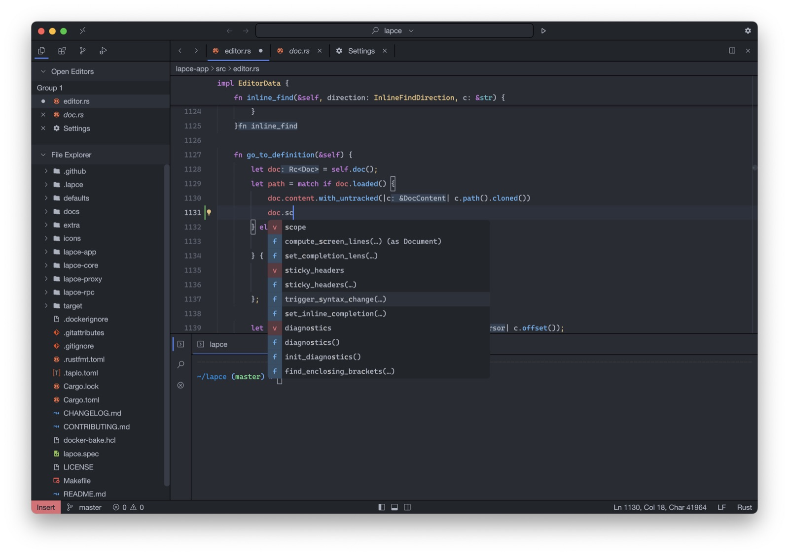</a></p>

| | Before: Visual Studio Code | After: Lapce |
|---|---|---|
| **Built with** | Electron | Rust · Floem · wgpu |
| **Download** | [~329 MB download, ~987 MB installed](https://update.code.visualstudio.com/1.141.0/darwin-arm64/stable) | Not published |
| **Memory** | [3-4 GB+](https://zed.dev/compare/vscode)<br><sub>with many extensions; competitor (Zed) comparison page, 2026-05-01</sub> | Not published |
| **Runs on** | Any Mac | Not stated |

**Why switch:** Built-in LSP support · First-class toggleable Vim-style modal editing · Built-in remote development  
**Watch out:** Still pre-1.0 · WASI plugin system, not VS Code extensions · Speed claims are qualitative only  
**Status:** Pre-1.0, active repo (last release Jan 2026), latest release `v0.4.6` (2026-01-21)

### Ghostty

🟢 **Native** · AppKit · replaces **Hyper** · [`ghostty-org/ghostty`](https://github.com/ghostty-org/ghostty)

  

Fast terminal emulator with a real native macOS UI and GPU rendering, plus an embeddable libghostty core.

<p><a href="https://github.com/ghostty-org/ghostty">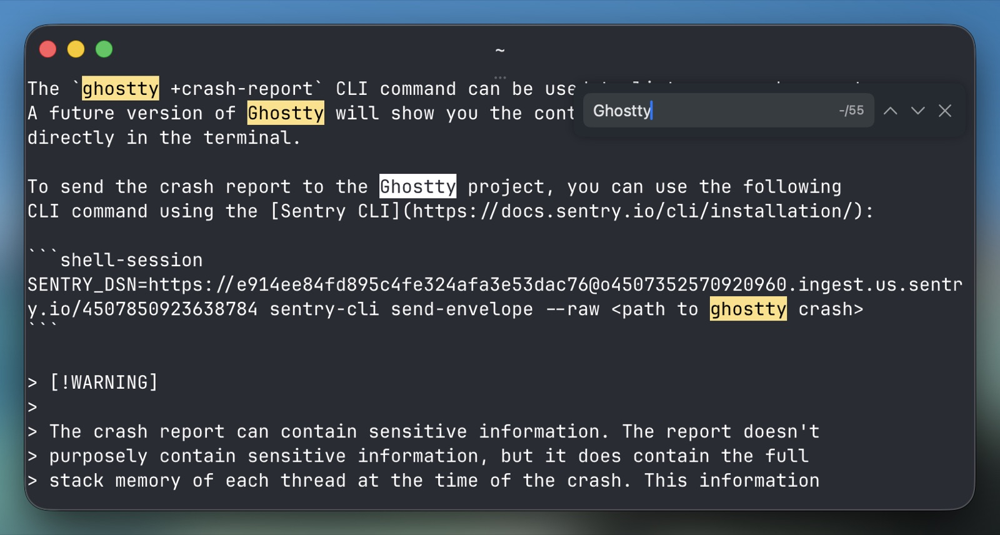</a></p>

| | Before: Hyper | After: Ghostty |
|---|---|---|
| **Built with** | Electron | Zig · Swift/AppKit/SwiftUI · Metal |
| **Download** | [~88 MB download, ~371 MB installed](https://github.com/vercel/hyper/releases/download/v3.4.1/Hyper-3.4.1-mac-arm64.zip) | Not published |
| **Memory** | [~170 MB vanilla, more with plugins](https://github.com/vercel/hyper/issues/3561)<br><sub>Windows 10, Hyper 3.0.0 canary, 2019-04-10</sub> | Not published |
| **Throughput** | n/a | [~100x faster than Terminal.app and iTerm](https://github.com/ghostty-org/ghostty#readme) |
| **Runs on** | Any Mac | macOS 13+ |

**Why switch:** Platform-native tabs, splits and windows · Metal renderer with SIMD-optimized parser · Wide modern protocol support (Kitty graphics, sync rendering)  
**Watch out:** No GitHub releases; download from ghostty.org · Benchmark claim is approximate, no published numbers · A terminal, not an AI or remote workspace like Warp  
**Status:** Stable, mature

### kitty

🟢 **Native** · GPU-rendered · replaces **Hyper** · [`kovidgoyal/kitty`](https://github.com/kovidgoyal/kitty)

  

GPU-based, keyboard-driven terminal with tiling layouts and its own graphics protocol, scriptable in Python.

<p><a href="https://github.com/kovidgoyal/kitty">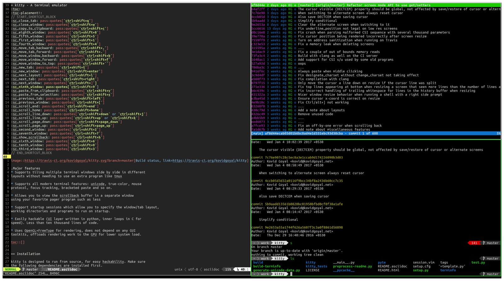</a></p>

| | Before: Hyper | After: kitty |
|---|---|---|
| **Built with** | Electron | C · Python · OpenGL |
| **Download** | [~88 MB download, ~371 MB installed](https://github.com/vercel/hyper/releases/download/v3.4.1/Hyper-3.4.1-mac-arm64.zip) | Not published |
| **Memory** | [~170 MB vanilla, more with plugins](https://github.com/vercel/hyper/issues/3561)<br><sub>Windows 10, Hyper 3.0.0 canary, 2019-04-10</sub> | Not published |
| **Throughput** | n/a | [134.55 MB/s average (vs 54.05 Alacritty)](https://sw.kovidgoyal.net/kitty/performance/) (Linux) |
| **CPU** | n/a | [6-8% while scrolling in less](https://sw.kovidgoyal.net/kitty/performance/) (Linux) |
| **Input latency** | n/a | [tied best with Terminal.app on macOS (no number given)](https://sw.kovidgoyal.net/kitty/performance/) |
| **Runs on** | Any Mac | Not stated |

**Why switch:** Built-in tiling layouts, tabs and splits · Kitty graphics protocol for images in the terminal · Scriptable via kittens and remote control  
**Watch out:** Not AppKit-native chrome · Config file driven, steeper setup · Published benchmarks run on Linux hardware  
**Status:** Mature, latest release `v0.49.2` (2026-10-01)

### Alacritty

🟢 **Native** · GPU-rendered · replaces **Hyper** · [`alacritty/alacritty`](https://github.com/alacritty/alacritty)

  

Minimal OpenGL terminal emulator in Rust that leaves tabs and splits to tmux and puts its effort into raw speed.

<p><a href="https://github.com/alacritty/alacritty"></a></p>

| | Before: Hyper | After: Alacritty |
|---|---|---|
| **Built with** | Electron | Rust · OpenGL |
| **Download** | [~88 MB download, ~371 MB installed](https://github.com/vercel/hyper/releases/download/v3.4.1/Hyper-3.4.1-mac-arm64.zip) | Not published |
| **Memory** | [~170 MB vanilla, more with plugins](https://github.com/vercel/hyper/issues/3561)<br><sub>Windows 10, Hyper 3.0.0 canary, 2019-04-10</sub> | Not published |
| **Throughput** | n/a | [Top vtebench scores (no number given)](https://github.com/alacritty/alacritty#faq) |
| **Runs on** | Any Mac | macOS 10.12+ |

**Why switch:** GPU-accelerated rendering · Sensible defaults with a single TOML config · Cross-platform: macOS, Linux, BSD, Windows  
**Watch out:** No tabs or splits, pair it with tmux or a window manager · README still calls it beta · No GUI settings editor  
**Status:** Mature / popular (README still labels it beta), latest release `v0.17.0` (2026-04-06)

### GitUp

🟢 **Native** · AppKit · replaces **GitKraken Desktop** · [`git-up/GitUp`](https://github.com/git-up/GitUp)

  

Native Mac Git client that talks straight to the Git database and lets you edit history by manipulating the commit graph.

<p><a href="https://github.com/git-up/GitUp">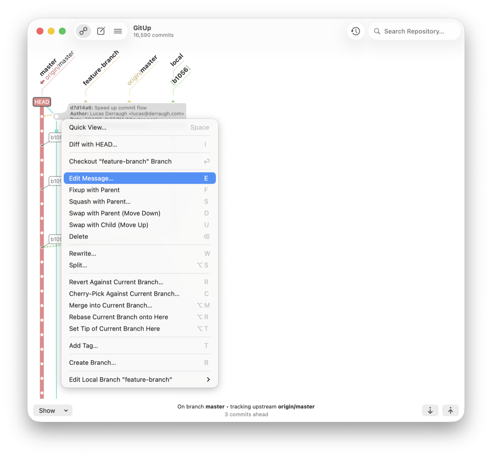</a></p>

| | Before: GitKraken Desktop | After: GitUp |
|---|---|---|
| **Built with** | Electron | Objective-C · AppKit · libgit2 (GitUpKit) |
| **Download** | [~218 MB download, ~1.3 GB installed](https://api.gitkraken.dev/releases/production/darwin/arm64/12.6.0/GitKraken-v12.6.0.zip) | Not published |
| **Memory** | Not published | Not published |
| **Ui speed** | n/a | [Faster than the command line (qualitative)](https://github.com/git-up/GitUp#readme) |
| **Runs on** | Any Mac | macOS 12.4+ |

**Why switch:** Live, editable repo graph · Unlimited undo/redo, even for rebases and merges · Instant search across the entire repo including diffs  
**Watch out:** Mac only · No pull request or issue tracking features · macOS minimum taken from build settings, not stated in README  
**Status:** Mature / active, latest release `v1.5.0` (2026-07-15)

### GitButler

🟡 **Hybrid** · Tauri · replaces **GitKraken Desktop** · [`gitbutlerapp/gitbutler`](https://github.com/gitbutlerapp/gitbutler)

  -444?style=flat-square)

Tauri Git client built around parallel and stacked branches, with drag-and-drop commit surgery and a matching `but` CLI.

<p><a href="https://github.com/gitbutlerapp/gitbutler">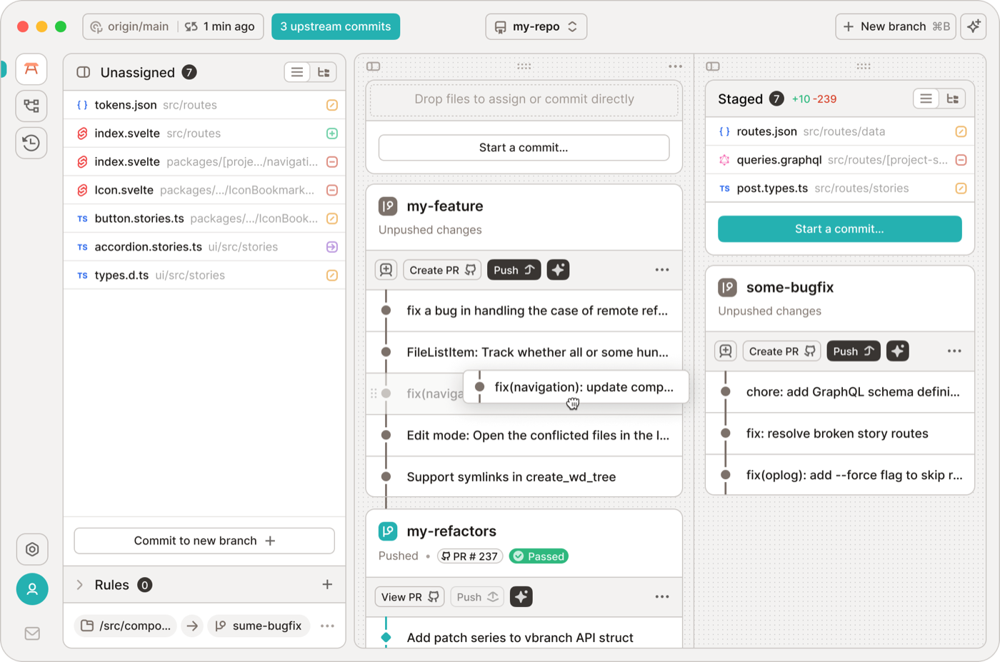</a></p>

| | Before: GitKraken Desktop | After: GitButler |
|---|---|---|
| **Built with** | Electron | Rust · Tauri · Svelte · TypeScript |
| **Download** | [~218 MB download, ~1.3 GB installed](https://api.gitkraken.dev/releases/production/darwin/arm64/12.6.0/GitKraken-v12.6.0.zip) | Not published |
| **Memory** | Not published | Not published |
| **Runs on** | Any Mac | Not stated |

**Why switch:** Stacked and parallel branches without switching · Drag-and-drop commit edits, no rebase -i · Undo timeline for every operation  
**Watch out:** Tauri webview UI, not native widgets · Fair Source license, not OSI open source · No published size or memory numbers  
**Status:** Mature / active, latest release `release/0.22.3` (2026-08-29)

### Lazygit

⌨️ **Terminal** · Terminal UI · replaces **GitKraken Desktop** · [`jesseduffield/lazygit`](https://github.com/jesseduffield/lazygit)

  

Keyboard-driven terminal UI for Git that makes hunk staging, interactive rebase and cherry-picking a keypress away.

<p><a href="https://github.com/jesseduffield/lazygit">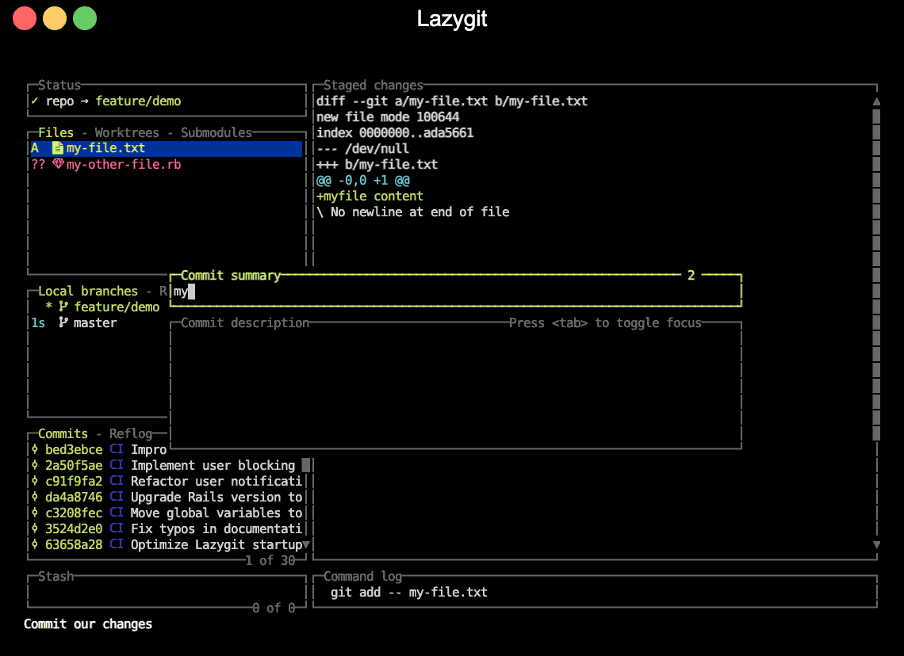</a></p>

| | Before: GitKraken Desktop | After: Lazygit |
|---|---|---|
| **Built with** | Electron | Go · gocui terminal UI |
| **Download** | [~218 MB download, ~1.3 GB installed](https://api.gitkraken.dev/releases/production/darwin/arm64/12.6.0/GitKraken-v12.6.0.zip) | Not published |
| **Memory** | Not published | Not published |
| **Runs on** | Any Mac | Not stated |

**Why switch:** Stage individual hunks or lines with a keypress · Interactive rebase without editing a TODO file · Cherry-pick, bisect and undo built in  
**Watch out:** Terminal only · GitUI's own benchmark shows it using 2.6 GB on the full Linux repo · No hosted PR review UI  
**Status:** Mature / popular, latest release `v0.66.0` (2026-10-05)

### GitUI

⌨️ **Terminal** · Terminal UI · replaces **GitKraken Desktop** · [`gitui-org/gitui`](https://github.com/gitui-org/gitui)

  

Rust terminal Git UI whose own benchmark parses the Linux repo in 24 s using 0.17 GB, against Lazygit's 57 s and 2.6 GB.

<p><a href="https://github.com/gitui-org/gitui">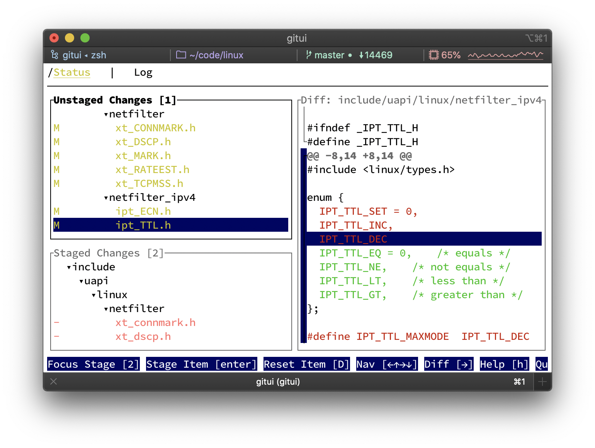</a></p>

| | Before: GitKraken Desktop | After: GitUI |
|---|---|---|
| **Built with** | Electron | Rust · ratatui · libgit2 |
| **Download** | [~218 MB download, ~1.3 GB installed](https://api.gitkraken.dev/releases/production/darwin/arm64/12.6.0/GitKraken-v12.6.0.zip) | [10 MB (lazygit 25 MB, tig 0.6 MB)](https://github.com/gitui-org/gitui#bench) (all) |
| **Memory** | Not published | [0.17 GB (lazygit 2.6 GB, tig 1.3 GB)](https://github.com/gitui-org/gitui#bench) (Linux kernel repo, 900k+ commits) |
| **Parse time** | n/a | [24 s (lazygit 57 s, tig 4 m 20 s)](https://github.com/gitui-org/gitui#bench) (Linux kernel repo, 900k+ commits) |
| **Runs on** | Any Mac | Not stated |

**Why switch:** Context-based help, no hotkeys to memorize · Async Git API keeps the UI responsive on huge repos · Stage files, hunks and lines  
**Watch out:** Self-described beta · No interactive rebase or branch graph yet · Benchmark is the author's own and dated  
**Status:** Beta (per README) / active, latest release `v0.28.1` (2026-03-24)

### Yaak

🟡 **Hybrid** · Tauri · replaces **Postman** · [`mountain-loop/yaak`](https://github.com/mountain-loop/yaak)

  

Offline-first Tauri API client for REST, GraphQL, gRPC, WebSocket and SSE that imports Postman and Insomnia collections.

<p><a href="https://github.com/mountain-loop/yaak">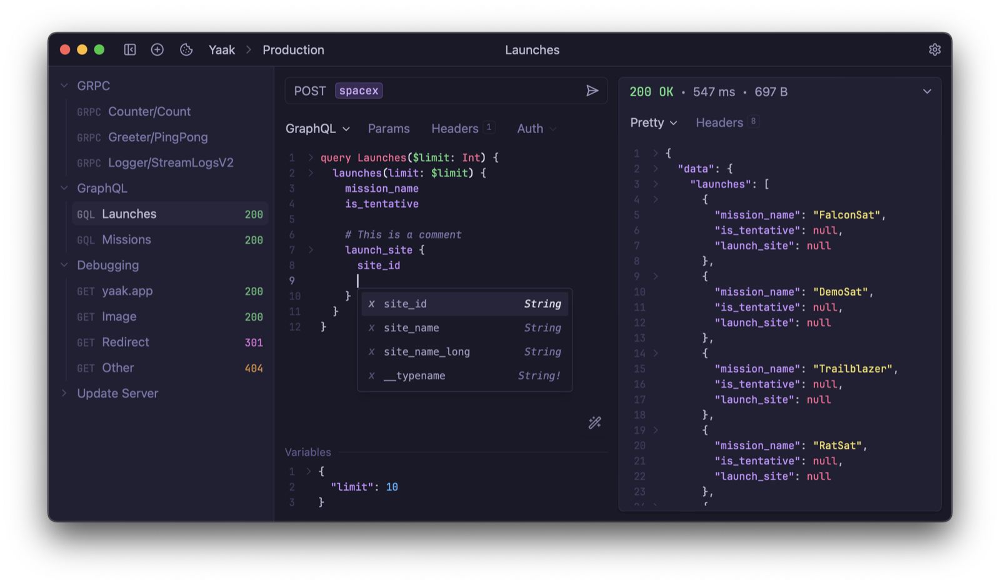</a></p>

| | Before: Postman | After: Yaak |
|---|---|---|
| **Built with** | Electron | Rust · Tauri · React |
| **Download** | [~206 MB download, ~615 MB installed](https://dl.pstmn.io/download/version/12.31.7/osx_arm64) | Not published |
| **Memory** | [~280 MB at launch, 450-600 MB with 3 collections, 700 MB+ with several workspaces](https://apidog.com/blog/postman-slow-bloated-2026-alternatives/)<br><sub>M2 MacBook Pro 16 GB; published by competitor Apidog, 2026</sub> | Not published |
| **Scale** | n/a | [3,286 requests without lag](https://yaak.app) |
| **Runs on** | Any Mac | Not stated |

**Why switch:** Offline-first, no account needed · REST, GraphQL, gRPC, WebSocket and SSE in one app · Workspaces mirror to the filesystem for Git sync  
**Watch out:** Tauri webview UI, not native widgets · Prebuilt binaries need a license for commercial use · No published RAM or size numbers  
**Status:** Mature / active, latest release `v2026.8.1` (2026-09-23)

### TablePro

🟢 **Native** · SwiftUI · replaces **TablePlus** · [`TableProApp/TablePro`](https://github.com/TableProApp/TablePro)

  

Open source native Mac database client aiming to be TablePlus without the closed source, covering 37 SQL and NoSQL engines.

<p><a href="https://github.com/TableProApp/TablePro">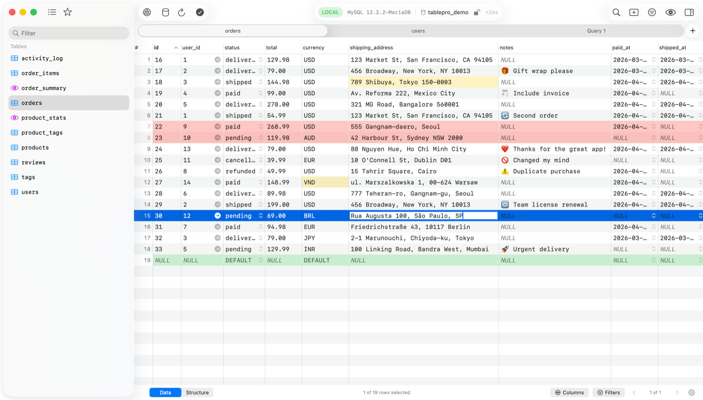</a></p>

| | Before: TablePlus | After: TablePro |
|---|---|---|
| **Built with** | Native | Swift · SwiftUI + AppKit · native drivers |
| **Download** | [~156 MB download, ~718 MB installed](https://files.tableplus.com/macos/818/TablePlus.dmg) | Not published |
| **Memory** | Not published | Not published |
| **Runs on** | Any Mac | macOS 13+ |

**Why switch:** No Electron, no JDBC, no JavaScript runtime · Native tabs, multi-window and split panes · MCP server for Cursor, Raycast and Claude Desktop  
**Watch out:** Some features (iCloud Sync, Compare & Sync) need a paid license · Many engines ship as on-demand plugins · No published size or memory numbers  
**Status:** Growing / active, latest release `v0.79.0` (2026-10-09)

### Tusk

🟢 **Native** · GPU-rendered · replaces **DBeaver Community** · [`alpcanaydin/tusk`](https://github.com/alpcanaydin/tusk)

  

Keyboard-first database client on Zed's GPUI framework, with a GPU-rendered virtualized grid and no Electron or webview.

<p><a href="https://github.com/alpcanaydin/tusk">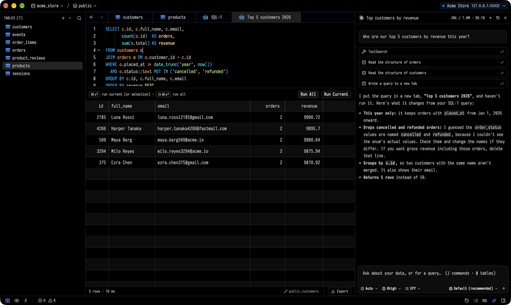</a></p>

| | Before: DBeaver Community | After: Tusk |
|---|---|---|
| **Built with** | Java / Eclipse RCP | Rust · GPUI · sqlx |
| **Download** | [~123 MB download, ~193 MB installed](https://dbeaver.io/files/26.2.2/dbeaver-ce-26.2.2-macos-aarch64.dmg) | Not published |
| **Memory** | [1 GB default max heap (-Xmx1024m), users raise to 2-4 GB](https://github.com/dbeaver/dbeaver/issues/35837)<br><sub>default dbeaver.ini JVM heap cap, not measured usage, 2024-10-06</sub> | Not published |
| **Grid scale** | n/a | [Millions of rows scroll smoothly (no number for RAM or fps)](https://github.com/alpcanaydin/tusk#why-tusk) |
| **Runs on** | Any Mac | macOS 14+, Apple Silicon only |

**Why switch:** Command palette for everything · Pending edits saved together in one transaction · AI writes queries into a new tab but never runs them  
**Watch out:** Very young (v0.2) · macOS build is Apple Silicon only · 20 database connectors, verify each before production use  
**Status:** Young / active, latest release `v0.2.1` (2026-09-30)

### FSNotes

🟢 **Native** · AppKit · replaces **Notion** · [`glushchenko/fsnotes`](https://github.com/glushchenko/fsnotes)

  

Native Mac and iOS notes app that keeps every note as a portable Markdown file, with fast search across 10,000+ notes.

<p><a href="https://github.com/glushchenko/fsnotes">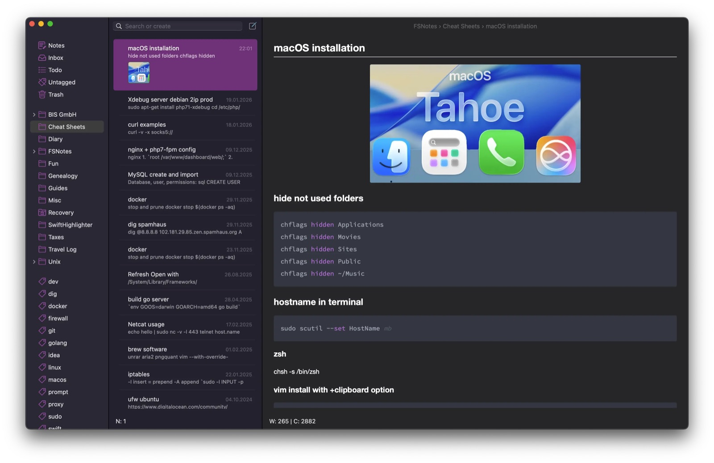</a></p>

| | Before: Notion | After: FSNotes |
|---|---|---|
| **Built with** | Electron | Swift · AppKit · plain Markdown files |
| **Download** | [~125 MB download, ~480 MB installed](https://desktop-release.notion-static.com/Notion-7.37.1-arm64.dmg) | Not published |
| **Memory** | Not published | Not published |
| **Scale** | n/a | [10,000+ notes](https://github.com/glushchenko/fsnotes#why-choose-fsnotes) (macOS / iOS) |
| **Runs on** | Any Mac | macOS 12.4+ |

**Why switch:** Notes are plain Markdown files, no lock-in · iCloud Drive, Dropbox and Git backups · AES-256 encrypted notes, Mermaid and MathJax  
**Watch out:** No Notion-style databases or real-time collaboration · Signed builds are paid on the App Store · macOS minimum taken from build settings, not stated in README  
**Status:** Mature / active, latest release `v7.3.6` (2026-10-09)

---

## Before you switch

Most of these are unofficial clients. That is the point, and also the risk.

- **Accounts can break or get flagged.** Discord, WhatsApp and Spotify do not bless third-party clients. Protocol changes can break them overnight, and user-token logins can violate terms of service.
- **Feature gaps are real.** Calls, screen sharing, huddles and DRM playback are the usual missing pieces. Check the ones you rely on.
- **Check the build.** Look for a tagged release and a signed, notarized app. A recent commit is not a release.
- **Open source is not audited.** Some projects say so directly (Nheko's encryption, for one). Read their security notes before trusting them with sensitive chats or mailboxes.
- **Measure on your own Mac.** Activity Monitor's Memory and Energy tabs after a fresh launch and initial sync, same account, same views. Then send us the numbers.

## Contributing

The README is generated. Edit `data/clients.json` (schema in [`data/SCHEMA.md`](data/SCHEMA.md)) or `data/baselines.json`, drop a screenshot from the project's repo into `assets/screenshots/`, then run:

```sh
ruby scripts/build-readme.rb
```

Rules of the list:

1. It must be a real alternative to an app or site people already use, with a public repo.
2. Screenshots come from the project's own repo or website.
3. Every number links to where it was published. No source, no number.

See [CONTRIBUTING.md](CONTRIBUTING.md) for details.

## License

[](https://creativecommons.org/publicdomain/zero/1.0/)

The list text and data are CC0. Screenshots belong to their respective projects and are used to illustrate them.

<sub>Data snapshot: October 10, 2026. Star counts and update dates in badges are live.</sub>

